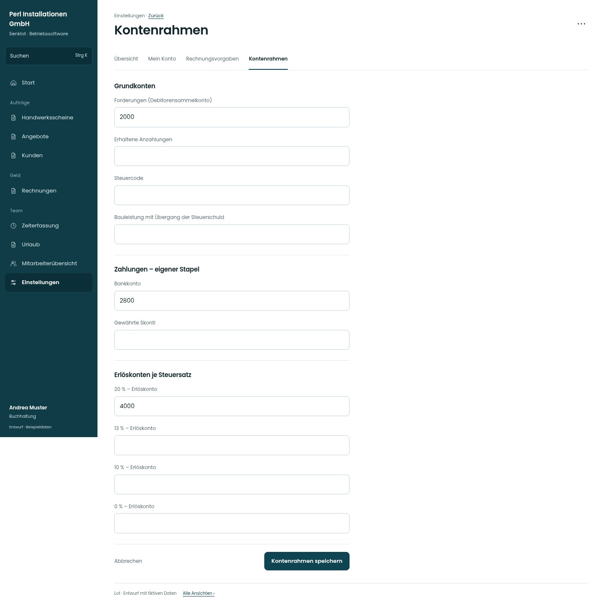

# Kontenrahmen

[Zur Übersicht](../README.md) · [Bereich: Einstellungen](../bereiche/einstellungen.md)

**Einstellungen · Buchhaltung · /settings/konten**

Gestaltungsentwurf mit fiktiven Beispieldaten. Aktionen und Datenänderungen sind lokal simuliert, ohne Backend.

[Desktop](../bilder/149-kontenrahmen-desktop.jpg) · [Tablet](../bilder/149-kontenrahmen-tablet.jpg) · [Mobil](../bilder/149-kontenrahmen-mobil.jpg)

## Aufbau

Grundkonten, Zahlungen und Erlöskonten gegliedert erhalten; keine dekorativen Vorschläge oder stilles Übernehmen fremder Konten.

## Vorhandene Funktionen für die spätere Umsetzung erhalten

- Abstimmung mit Kanzlei
- Steuercodes/Anzahlungen/Bauleistung
- Keine internen Kostensätze öffnen

## Register und Filter

- Übersicht → [einstellungen](einstellungen.md)
- Mein Konto → [konto](konto.md)
- Rechnungsvorgaben → [rechnungsvorgaben](rechnungsvorgaben.md)
- Kontenrahmen → [kontenrahmen](kontenrahmen.md)

## Felder im Beispiel

- Forderungen (Debitorensammelkonto)
- Erhaltene Anzahlungen
- Steuercode
- Bauleistung mit Übergang der Steuerschuld
- Bankkonto
- Gewährte Skonti
- 20 % – Erlöskonto
- 13 % – Erlöskonto
- 10 % – Erlöskonto
- 0 % – Erlöskonto

## Aktionen

- Kontenrahmen speichern
- Vorschlag einsetzen

## Quellen

Quellstand: `3e49090`.
- [src/features/settings/KontenrahmenView.tsx](https://github.com/juliandeutsch22/Prototype-App-Installateure/blob/3e49090d4054ebbd3ecbce6ab583bb944c2c0770/src/features/settings/KontenrahmenView.tsx)

Die Screens zeigen die vorgesehenen Bedienwege. Reale Speicherung, vollständige Rollenprüfung, Berechnungen, Exporte, Benachrichtigungen und Integrationen müssen bei einer Umsetzung gegen die App geprüft werden.
