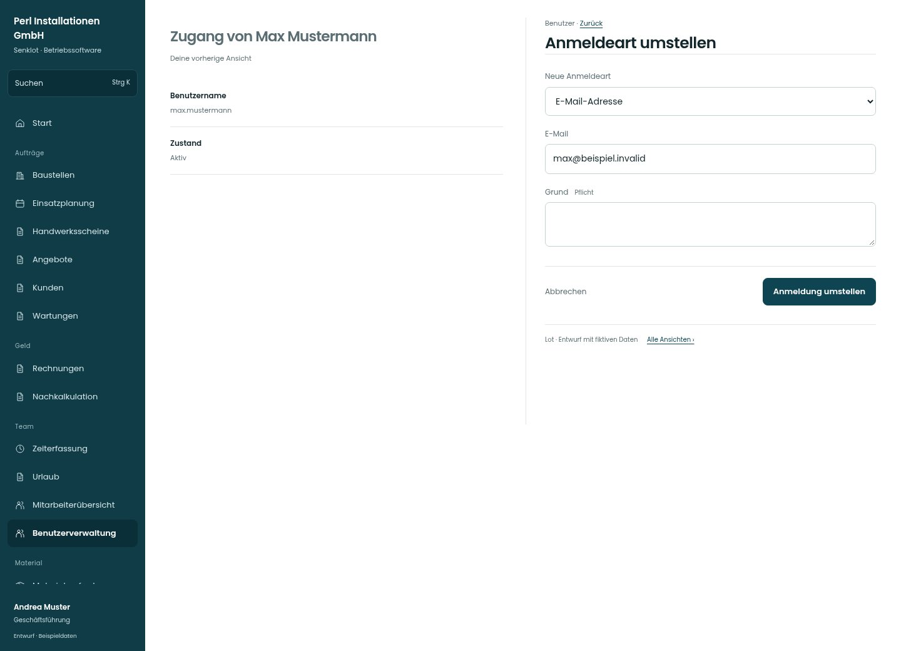

# Anmeldeart umstellen

[Zur Übersicht](../README.md) · [Bereich: Benutzer](../bereiche/benutzer.md)

**Benutzer · Geschäftsführung · /user-mgmt/:uid · Konto umstellen**

Gestaltungsentwurf mit fiktiven Beispieldaten. Aktionen und Datenänderungen sind lokal simuliert, ohne Backend.

[Desktop](../bilder/132-konto-umstellen-desktop.jpg) · [Tablet](../bilder/132-konto-umstellen-tablet.jpg) · [Mobil](../bilder/132-konto-umstellen-mobil.jpg)

## Aufbau

Identitätswechsel bleibt ein ausdrücklich benannter geschützter Ablauf; kein freies Umstellen im Stammdatenformular.

## Vorhandene Funktionen für die spätere Umsetzung erhalten

- Identität bleibt bestehen
- Passwortübergabe und Wirkung ausdrücklich zeigen
- Kein stiller Identitätswechsel

## Felder im Beispiel

- Neue Anmeldeart
- E-Mail
- Benutzername
- Grund (Pflichtfeld)

## Aktionen

- Anmeldung umstellen

## Quellen

Quellstand: `3e49090`.
- [src/features/users/KontoUmstellen.tsx](https://github.com/juliandeutsch22/Prototype-App-Installateure/blob/3e49090d4054ebbd3ecbce6ab583bb944c2c0770/src/features/users/KontoUmstellen.tsx)

Die Screens zeigen die vorgesehenen Bedienwege. Reale Speicherung, vollständige Rollenprüfung, Berechnungen, Exporte, Benachrichtigungen und Integrationen müssen bei einer Umsetzung gegen die App geprüft werden.
