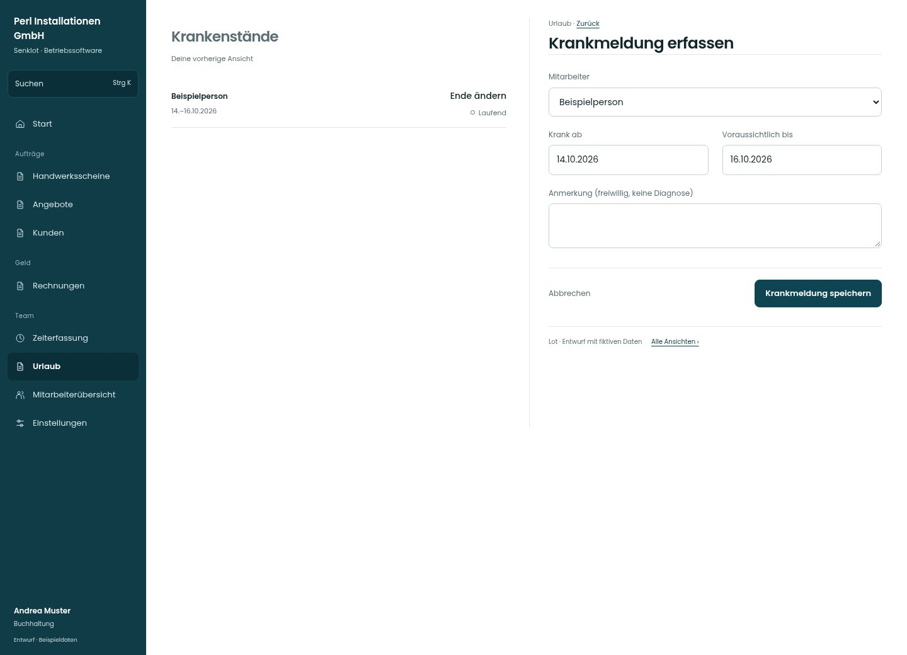

# Krankmeldung erfassen

[Zur Übersicht](../README.md) · [Bereich: Urlaub](../bereiche/urlaub.md)

**Urlaub · Buchhaltung · /vacations · Büro-Krankmeldung**

Gestaltungsentwurf mit fiktiven Beispieldaten. Aktionen und Datenänderungen sind lokal simuliert, ohne Backend.

[Desktop](../bilder/116-krank-buero-desktop.jpg) · [Tablet](../bilder/116-krank-buero-tablet.jpg) · [Mobil](../bilder/116-krank-buero-mobil.jpg)

## Aufbau

Person und Zeitraum sind der Vorgang; dieselben vertraulichen Angaben und Rechte wie im Bestand verwenden.

## Vorhandene Funktionen für die spätere Umsetzung erhalten

- Siehe Quellcode und Seitenübersicht.

## Felder im Beispiel

- Mitarbeiter
- Krank ab
- Voraussichtlich bis
- Anmerkung (freiwillig, keine Diagnose)

## Aktionen

- Krankmeldung speichern

## Quellen

Quellstand: `3e49090`.
- [src/features/vacations/Krankmeldungen.tsx](https://github.com/juliandeutsch22/Prototype-App-Installateure/blob/3e49090d4054ebbd3ecbce6ab583bb944c2c0770/src/features/vacations/Krankmeldungen.tsx)

Die Screens zeigen die vorgesehenen Bedienwege. Reale Speicherung, vollständige Rollenprüfung, Berechnungen, Exporte, Benachrichtigungen und Integrationen müssen bei einer Umsetzung gegen die App geprüft werden.
