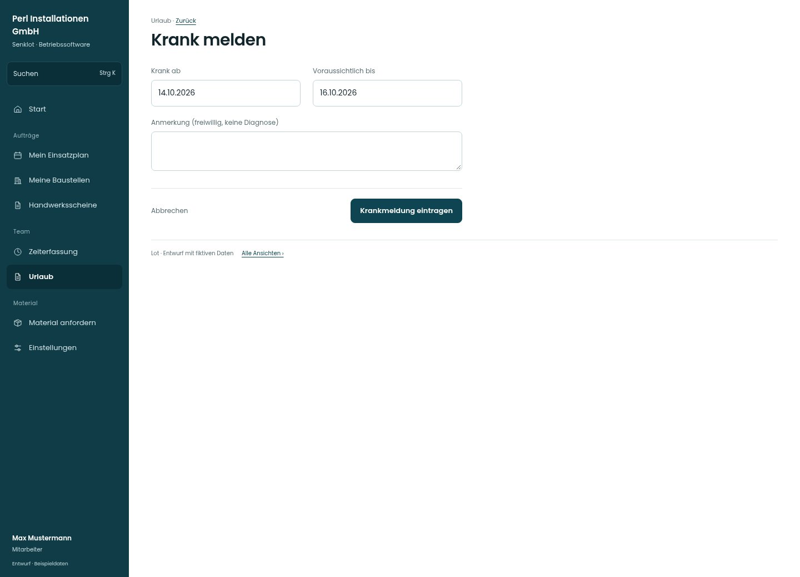

# Krank melden

[Zur Übersicht](../README.md) · [Bereich: Urlaub](../bereiche/urlaub.md)

**Urlaub · Mitarbeiter · /vacations · Krankmeldung**

Gestaltungsentwurf mit fiktiven Beispieldaten. Aktionen und Datenänderungen sind lokal simuliert, ohne Backend.

[Desktop](../bilder/114-krank-melden-desktop.jpg) · [Tablet](../bilder/114-krank-melden-tablet.jpg) · [Mobil](../bilder/114-krank-melden-mobil.jpg)

## Aufbau

Beginn, voraussichtliches Ende und freiwillige Notiz reichen; keine Diagnose oder Urlaubsfreigabe abfragen.

## Vorhandene Funktionen für die spätere Umsetzung erhalten

- Krankmeldung ist kein Urlaubsantrag
- Keine Diagnose abfragen
- Ende ändern/Löschen nach Recht

## Felder im Beispiel

- Krank ab
- Voraussichtlich bis
- Anmerkung (freiwillig, keine Diagnose)

## Aktionen

- Krankmeldung eintragen

## Quellen

Quellstand: `3e49090`.
- [src/features/vacations/Krankmeldungen.tsx](https://github.com/juliandeutsch22/Prototype-App-Installateure/blob/3e49090d4054ebbd3ecbce6ab583bb944c2c0770/src/features/vacations/Krankmeldungen.tsx)
- [src/features/vacations/VacationsView.tsx](https://github.com/juliandeutsch22/Prototype-App-Installateure/blob/3e49090d4054ebbd3ecbce6ab583bb944c2c0770/src/features/vacations/VacationsView.tsx)

Die Screens zeigen die vorgesehenen Bedienwege. Reale Speicherung, vollständige Rollenprüfung, Berechnungen, Exporte, Benachrichtigungen und Integrationen müssen bei einer Umsetzung gegen die App geprüft werden.
