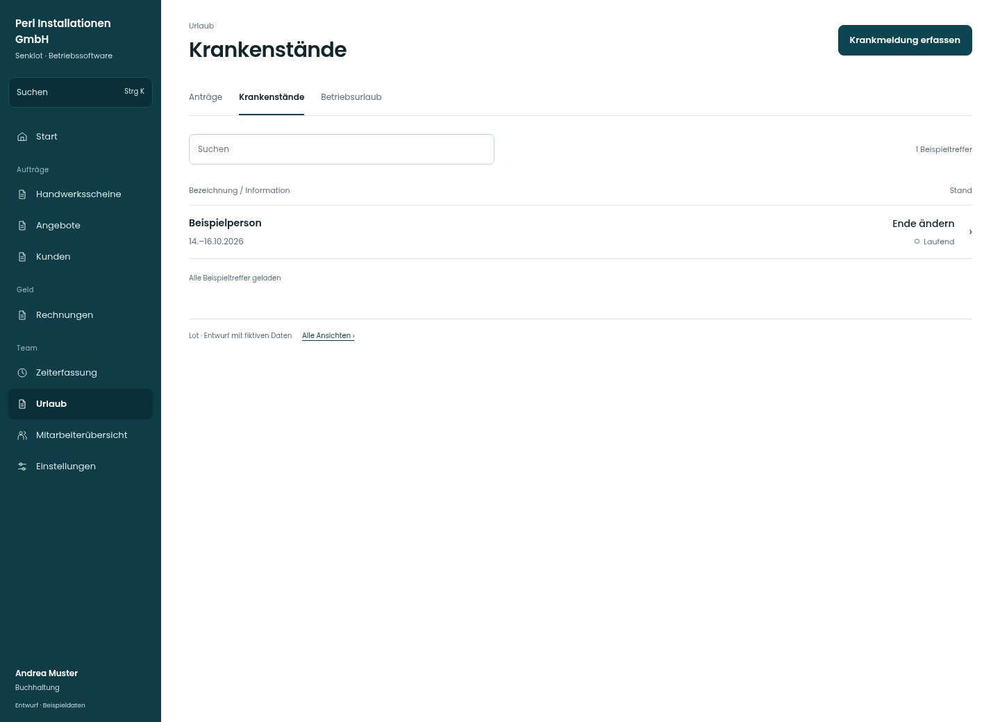

# Krankenstände

[Zur Übersicht](../README.md) · [Bereich: Urlaub](../bereiche/urlaub.md)

**Urlaub · Buchhaltung · /vacations · Krankenstände**

Gestaltungsentwurf mit fiktiven Beispieldaten. Aktionen und Datenänderungen sind lokal simuliert, ohne Backend.

[Desktop](../bilder/115-krankenstaende-desktop.jpg) · [Tablet](../bilder/115-krankenstaende-tablet.jpg) · [Mobil](../bilder/115-krankenstaende-mobil.jpg)

## Aufbau

Laufende Meldung und Ende ändern im konkreten Kontext; vertrauliche Gründe nicht über die Teamplanung offenlegen.

## Vorhandene Funktionen für die spätere Umsetzung erhalten

- Gesundheitsdaten nicht an Projektleitung/Team
- Ende ändern und Löschen bestätigt

## Register und Filter

- Anträge → [urlaub-buero](urlaub-buero.md)
- Krankenstände → [krankenstaende](krankenstaende.md)
- Betriebsurlaub → [betriebsurlaub](betriebsurlaub.md)

## Aktionen

- Krankmeldung erfassen

## Quellen

Quellstand: `3e49090`.
- [src/features/vacations/Krankmeldungen.tsx](https://github.com/juliandeutsch22/Prototype-App-Installateure/blob/3e49090d4054ebbd3ecbce6ab583bb944c2c0770/src/features/vacations/Krankmeldungen.tsx)

Die Screens zeigen die vorgesehenen Bedienwege. Reale Speicherung, vollständige Rollenprüfung, Berechnungen, Exporte, Benachrichtigungen und Integrationen müssen bei einer Umsetzung gegen die App geprüft werden.
