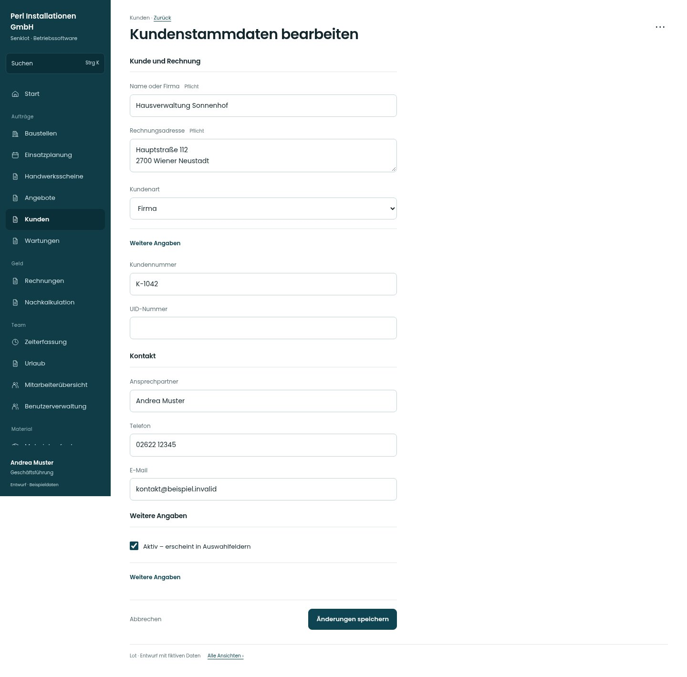

# Kundenstammdaten bearbeiten

[Zur Übersicht](../README.md) · [Bereich: Kunden](../bereiche/kunden.md)

**Kunden · Geschäftsführung · /customers/:id · Stammdaten**

Gestaltungsentwurf mit fiktiven Beispieldaten. Aktionen und Datenänderungen sind lokal simuliert, ohne Backend.

[Desktop](../bilder/020-kunde-bearbeiten-desktop.jpg) · [Tablet](../bilder/020-kunde-bearbeiten-tablet.jpg) · [Mobil](../bilder/020-kunde-bearbeiten-mobil.jpg)

## Aufbau

Langes Formular in dieselben Gruppen wie Neuanlage teilen; UID-Abfrage und Löschen als separate bewusste Wege behalten.

## Vorhandene Funktionen für die spätere Umsetzung erhalten

- Ungespeichert-Warnung
- UID-Prüfung separat auslösbar
- Aktive Bezüge verhindern unzulässiges Löschen
- Verwaltung/Buchhaltung nur mit kundenPflegen; sonst lesend ohne Pflegeaktionen

## Felder im Beispiel

- Name oder Firma (Pflichtfeld)
- Rechnungsadresse (Pflichtfeld)
- Kundennummer
- Ansprechpartner
- Telefon
- E-Mail
- Kundenart
- UID-Nummer
- Notiz
- Aktiv – erscheint in Auswahlfeldern

## Aktionen

- Änderungen speichern
- UID prüfen
- Kunde löschen

## Quellen

Quellstand: `3e49090`.
- [src/features/customers/KundenakteView.tsx](https://github.com/juliandeutsch22/Prototype-App-Installateure/blob/3e49090d4054ebbd3ecbce6ab583bb944c2c0770/src/features/customers/KundenakteView.tsx)
- [src/features/customers/UidVies.tsx](https://github.com/juliandeutsch22/Prototype-App-Installateure/blob/3e49090d4054ebbd3ecbce6ab583bb944c2c0770/src/features/customers/UidVies.tsx)

Die Screens zeigen die vorgesehenen Bedienwege. Reale Speicherung, vollständige Rollenprüfung, Berechnungen, Exporte, Benachrichtigungen und Integrationen müssen bei einer Umsetzung gegen die App geprüft werden.
