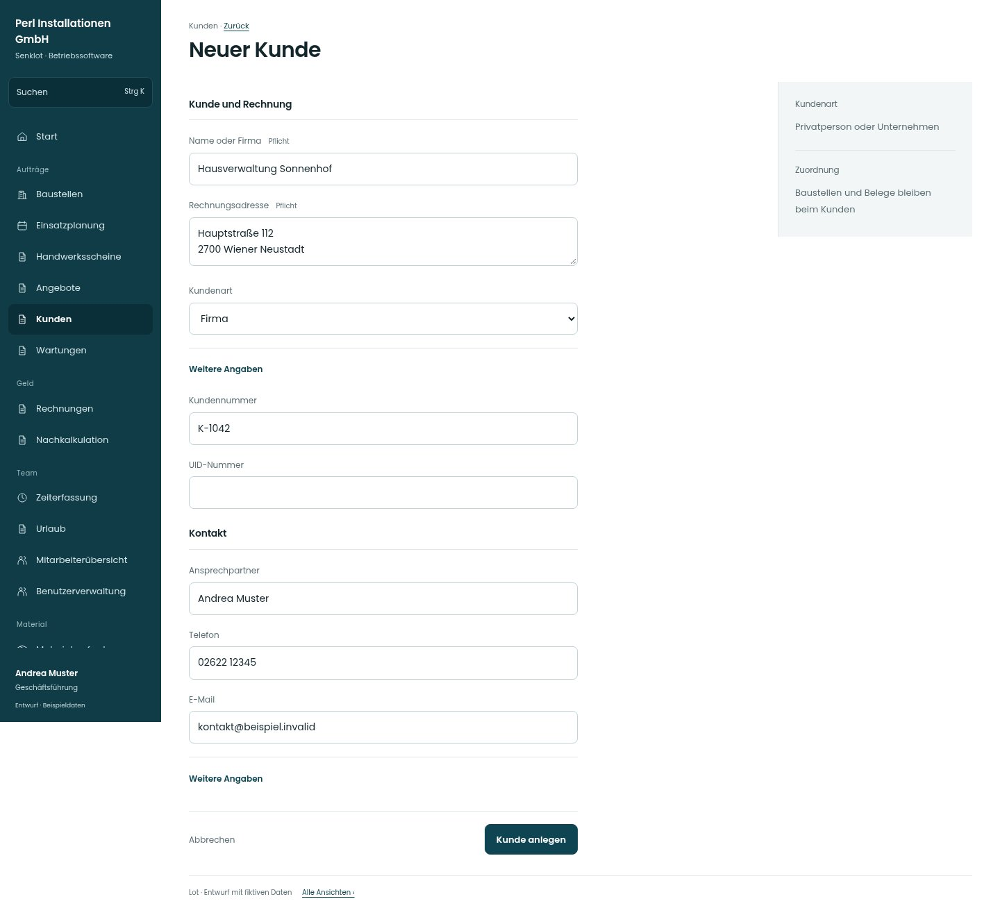

# Neuer Kunde

[Zur Übersicht](../README.md) · [Bereich: Kunden](../bereiche/kunden.md)

**Kunden · Geschäftsführung · /customers · Anlegen**

Gestaltungsentwurf mit fiktiven Beispieldaten. Aktionen und Datenänderungen sind lokal simuliert, ohne Backend.

[Desktop](../bilder/018-kunde-neu-desktop.jpg) · [Tablet](../bilder/018-kunde-neu-tablet.jpg) · [Mobil](../bilder/018-kunde-neu-mobil.jpg)

## Aufbau

Kunde und Rechnungsangaben, Kontakt und weitere Angaben gruppieren; Dublettenprüfung und Nummernregeln bleiben bestehen.

## Vorhandene Funktionen für die spätere Umsetzung erhalten

- Kunden pflegen nur mit Berechtigung
- Gleicher Name erfordert bewusste Bestätigung
- Verwaltung/Buchhaltung nur mit kundenPflegen; sonst lesend ohne Pflegeaktionen

## Felder im Beispiel

- Name oder Firma (Pflichtfeld)
- Rechnungsadresse (Pflichtfeld)
- Kundennummer
- Ansprechpartner
- Telefon
- E-Mail
- Kundenart
- UID-Nummer
- Notiz

## Aktionen

- Kunde anlegen

## Quellen

Quellstand: `3e49090`.
- [src/features/customers/CustomersView.tsx](https://github.com/juliandeutsch22/Prototype-App-Installateure/blob/3e49090d4054ebbd3ecbce6ab583bb944c2c0770/src/features/customers/CustomersView.tsx)

Die Screens zeigen die vorgesehenen Bedienwege. Reale Speicherung, vollständige Rollenprüfung, Berechnungen, Exporte, Benachrichtigungen und Integrationen müssen bei einer Umsetzung gegen die App geprüft werden.
