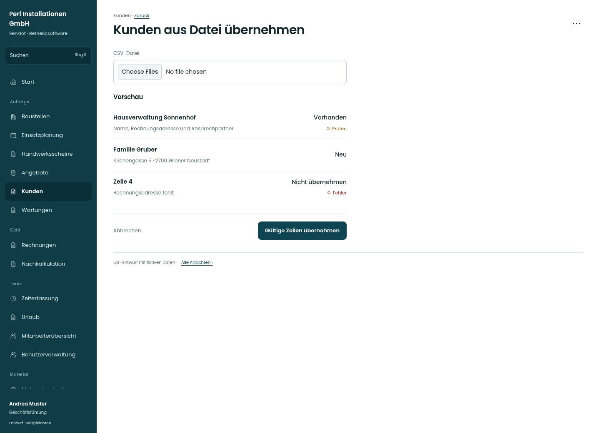

# Kunden aus Datei übernehmen

[Zur Übersicht](../README.md) · [Bereich: Kunden](../bereiche/kunden.md)

**Kunden · Geschäftsführung · /customers · CSV-Import**

Gestaltungsentwurf mit fiktiven Beispieldaten. Aktionen und Datenänderungen sind lokal simuliert, ohne Backend.

[Desktop](../bilder/021-kunden-import-desktop.jpg) · [Tablet](../bilder/021-kunden-import-tablet.jpg) · [Mobil](../bilder/021-kunden-import-mobil.jpg)

## Aufbau

Datei, Vorschau und Übernahme bilden einen nachvollziehbaren Ablauf; fehlerhafte und vorhandene Zeilen nicht als gültige neue Kunden tarnen.

## Vorhandene Funktionen für die spätere Umsetzung erhalten

- Vorschau vor Übernahme
- Vorhandene/fehlerhafte Zeilen getrennt
- Teilresultate sichtbar
- Verwaltung/Buchhaltung nur mit kundenPflegen; sonst lesend ohne Pflegeaktionen

## Felder im Beispiel

- CSV-Datei

## Aktionen

- Gültige Zeilen übernehmen
- Vorlage herunterladen

## Quellen

Quellstand: `3e49090`.
- [src/features/customers/KundenImport.tsx](https://github.com/juliandeutsch22/Prototype-App-Installateure/blob/3e49090d4054ebbd3ecbce6ab583bb944c2c0770/src/features/customers/KundenImport.tsx)

Die Screens zeigen die vorgesehenen Bedienwege. Reale Speicherung, vollständige Rollenprüfung, Berechnungen, Exporte, Benachrichtigungen und Integrationen müssen bei einer Umsetzung gegen die App geprüft werden.
