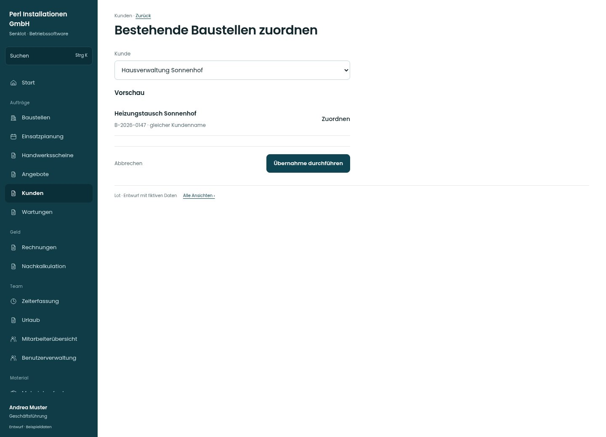

# Bestehende Baustellen zuordnen

[Zur Übersicht](../README.md) · [Bereich: Kunden](../bereiche/kunden.md)

**Kunden · Geschäftsführung · /customers · Übernahme**

Gestaltungsentwurf mit fiktiven Beispieldaten. Aktionen und Datenänderungen sind lokal simuliert, ohne Backend.

[Desktop](../bilder/022-kunden-zuordnen-desktop.jpg) · [Tablet](../bilder/022-kunden-zuordnen-tablet.jpg) · [Mobil](../bilder/022-kunden-zuordnen-mobil.jpg)

## Aufbau

Zielkunde und konkrete Vorschau stehen vor der Übernahme; bestehendes Baustellenänderungsrecht bleibt verbindlich.

## Vorhandene Funktionen für die spätere Umsetzung erhalten

- Erst Vorschau erstellen
- Baustellenänderungsrecht bleibt gesondert

## Felder im Beispiel

- Kunde

## Aktionen

- Übernahme durchführen

## Quellen

Quellstand: `3e49090`.
- [src/features/customers/CustomersView.tsx](https://github.com/juliandeutsch22/Prototype-App-Installateure/blob/3e49090d4054ebbd3ecbce6ab583bb944c2c0770/src/features/customers/CustomersView.tsx)

Die Screens zeigen die vorgesehenen Bedienwege. Reale Speicherung, vollständige Rollenprüfung, Berechnungen, Exporte, Benachrichtigungen und Integrationen müssen bei einer Umsetzung gegen die App geprüft werden.
