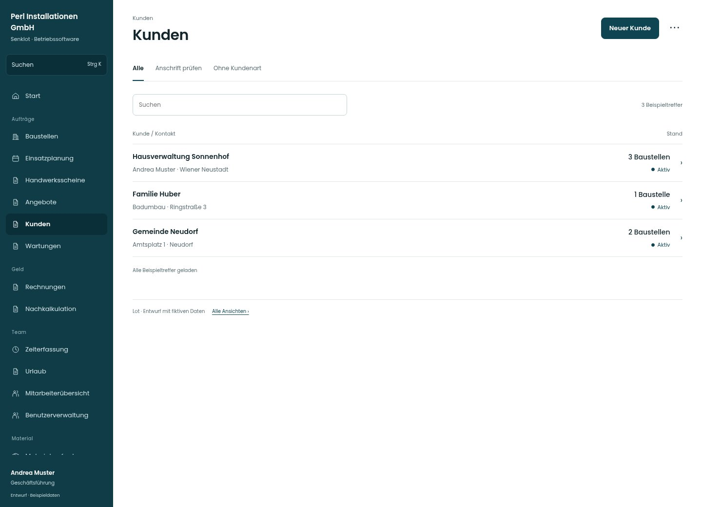

# Kunden

[Zur Übersicht](../README.md) · [Bereich: Kunden](../bereiche/kunden.md)

**Kunden · Geschäftsführung · /customers**

Gestaltungsentwurf mit fiktiven Beispieldaten. Aktionen und Datenänderungen sind lokal simuliert, ohne Backend.

[Desktop](../bilder/017-kunden-desktop.jpg) · [Tablet](../bilder/017-kunden-tablet.jpg) · [Mobil](../bilder/017-kunden-mobil.jpg)

## Aufbau

Kundenname und Kontakt tragen die Liste; Import und Zuordnung bleiben seltenere Seitenaktionen, Pflegeberechtigungen getrennt.

## Vorhandene Funktionen für die spätere Umsetzung erhalten

- Kundenpflegerecht je Benutzer
- Dublettenprüfung
- Import
- Übernahme bestehender Baustellen
- Verwaltung/Buchhaltung nur mit kundenPflegen; sonst lesend ohne Pflegeaktionen

## Register und Filter

- Alle → [kunden](kunden.md)
- Anschrift prüfen → [kunden-filter-1](kunden-filter-1.md)
- Ohne Kundenart → [kunden-filter-2](kunden-filter-2.md)

## Aktionen

- Neuer Kunde
- Kunden importieren
- Baustellen zuordnen

## Quellen

Quellstand: `3e49090`.
- [src/features/customers/CustomersView.tsx](https://github.com/juliandeutsch22/Prototype-App-Installateure/blob/3e49090d4054ebbd3ecbce6ab583bb944c2c0770/src/features/customers/CustomersView.tsx)

Die Screens zeigen die vorgesehenen Bedienwege. Reale Speicherung, vollständige Rollenprüfung, Berechnungen, Exporte, Benachrichtigungen und Integrationen müssen bei einer Umsetzung gegen die App geprüft werden.
