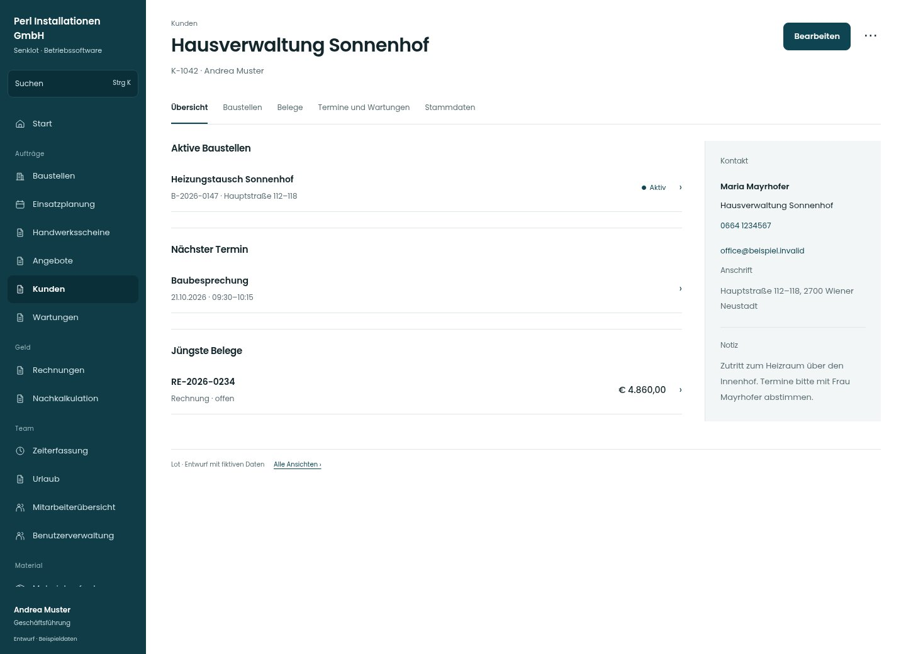

# Hausverwaltung Sonnenhof

[Zur Übersicht](../README.md) · [Bereich: Kunden](../bereiche/kunden.md)

**Kunden · Geschäftsführung · /customers/:id**

Gestaltungsentwurf mit fiktiven Beispieldaten. Aktionen und Datenänderungen sind lokal simuliert, ohne Backend.

[Desktop](../bilder/019-kundenakte-desktop.jpg) · [Tablet](../bilder/019-kundenakte-tablet.jpg) · [Mobil](../bilder/019-kundenakte-mobil.jpg)

## Aufbau

Kontaktwege direkt nutzbar machen und Baustellen vor seltenen Stammdatenaktionen zeigen; Belege bleiben berechtigungsabhängig.

## Vorhandene Funktionen für die spätere Umsetzung erhalten

- Rechnungen und Angebote nur nach Recht/Modul
- UID-/VIES-Prüfstatus
- Löschen und Deaktivieren getrennt
- Datenauskunft

## Register und Filter

- Übersicht → [kundenakte](kundenakte.md)
- Baustellen → [kundenakte-baustellen](kundenakte-baustellen.md)
- Belege → [kundenakte-belege](kundenakte-belege.md)
- Termine und Wartungen → [kundenakte-termine](kundenakte-termine.md)
- Stammdaten → [kundenakte-stammdaten](kundenakte-stammdaten.md)

## Aktionen

- Bearbeiten
- Datenauskunft

## Quellen

Quellstand: `3e49090`.
- [src/features/customers/KundenakteView.tsx](https://github.com/juliandeutsch22/Prototype-App-Installateure/blob/3e49090d4054ebbd3ecbce6ab583bb944c2c0770/src/features/customers/KundenakteView.tsx)
- [src/features/customers/UidVies.tsx](https://github.com/juliandeutsch22/Prototype-App-Installateure/blob/3e49090d4054ebbd3ecbce6ab583bb944c2c0770/src/features/customers/UidVies.tsx)
- [src/features/recht/Datenauskunft.tsx](https://github.com/juliandeutsch22/Prototype-App-Installateure/blob/3e49090d4054ebbd3ecbce6ab583bb944c2c0770/src/features/recht/Datenauskunft.tsx)

Die Screens zeigen die vorgesehenen Bedienwege. Reale Speicherung, vollständige Rollenprüfung, Berechnungen, Exporte, Benachrichtigungen und Integrationen müssen bei einer Umsetzung gegen die App geprüft werden.
