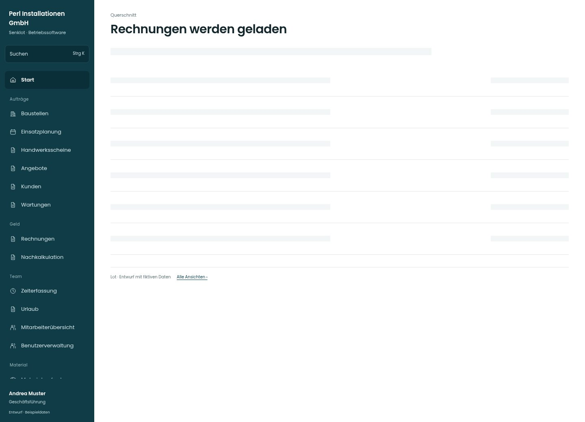

# Rechnungen werden geladen

[Zur Übersicht](../README.md) · [Bereich: Querschnitt](../bereiche/querschnitt.md)

**Querschnitt · Geschäftsführung · Ladezustand**

Gestaltungsentwurf mit fiktiven Beispieldaten. Aktionen und Datenänderungen sind lokal simuliert, ohne Backend.

[Desktop](../bilder/169-laden-desktop.jpg) · [Tablet](../bilder/169-laden-tablet.jpg) · [Mobil](../bilder/169-laden-mobil.jpg)

## Aufbau

Ruhige Platzhalter in passender Inhaltshöhe; keine Nullwerte als vorgetäuschte geladene Summen.

## Vorhandene Funktionen für die spätere Umsetzung erhalten

- Gleiche Inhaltshöhe
- Keine falschen Nullsummen
- Navigation bleibt stehen

## Quellen

Quellstand: `3e49090`.
- [src/components/States.tsx](https://github.com/juliandeutsch22/Prototype-App-Installateure/blob/3e49090d4054ebbd3ecbce6ab583bb944c2c0770/src/components/States.tsx)

Die Screens zeigen die vorgesehenen Bedienwege. Reale Speicherung, vollständige Rollenprüfung, Berechnungen, Exporte, Benachrichtigungen und Integrationen müssen bei einer Umsetzung gegen die App geprüft werden.
