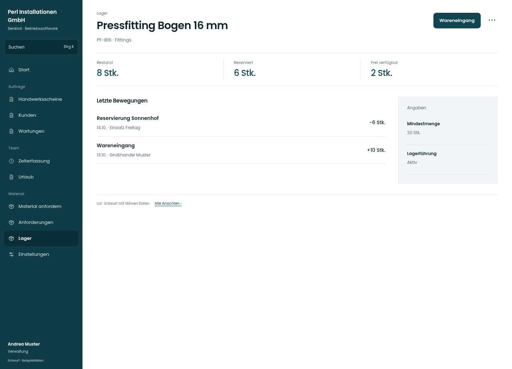

# Pressfitting Bogen 16 mm

[Zur Übersicht](../README.md) · [Bereich: Lager](../bereiche/lager.md)

**Lager · Verwaltung · /lager · Artikel**

Gestaltungsentwurf mit fiktiven Beispieldaten. Aktionen und Datenänderungen sind lokal simuliert, ohne Backend.

[Desktop](../bilder/072-lager-artikel-desktop.jpg) · [Tablet](../bilder/072-lager-artikel-tablet.jpg) · [Mobil](../bilder/072-lager-artikel-mobil.jpg)

## Aufbau

Bestand 8, reserviert 6 und frei 2 bleiben nachvollziehbar; Reservierung nicht als identischen physischen Abgang darstellen.

## Vorhandene Funktionen für die spätere Umsetzung erhalten

- Bewegungstypen nicht als identische Bestandsabgänge darstellen
- Negativer/Reservierter Bestand transparent
- Bestand 8 minus reserviert 6 = frei 2; diese Zahlen gelten für den gezeigten Artikel

## Aktionen

- Wareneingang
- Inventur
- Alle Bewegungen

## Quellen

Quellstand: `3e49090`.
- [src/features/orders/StockView.tsx](https://github.com/juliandeutsch22/Prototype-App-Installateure/blob/3e49090d4054ebbd3ecbce6ab583bb944c2c0770/src/features/orders/StockView.tsx)
- [src/features/orders/LagerDialoge.tsx](https://github.com/juliandeutsch22/Prototype-App-Installateure/blob/3e49090d4054ebbd3ecbce6ab583bb944c2c0770/src/features/orders/LagerDialoge.tsx)

Die Screens zeigen die vorgesehenen Bedienwege. Reale Speicherung, vollständige Rollenprüfung, Berechnungen, Exporte, Benachrichtigungen und Integrationen müssen bei einer Umsetzung gegen die App geprüft werden.
