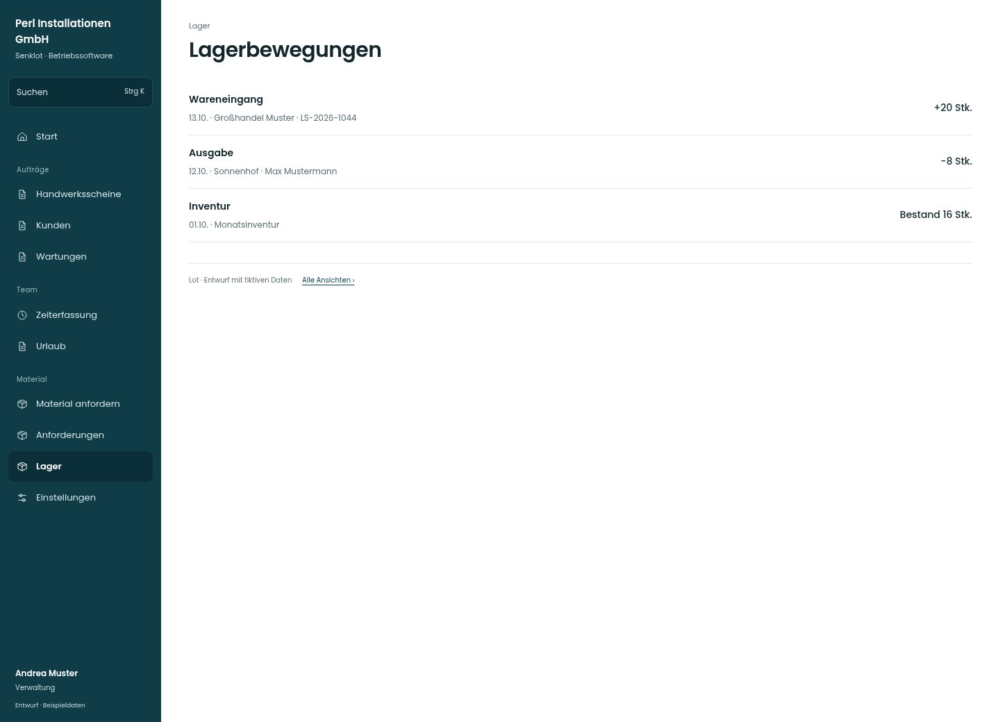

# Lagerbewegungen

[Zur Übersicht](../README.md) · [Bereich: Lager](../bereiche/lager.md)

**Lager · Verwaltung · /lager · Bewegungsprotokoll**

Gestaltungsentwurf mit fiktiven Beispieldaten. Aktionen und Datenänderungen sind lokal simuliert, ohne Backend.

[Desktop](../bilder/075-lager-bewegungen-desktop.jpg) · [Tablet](../bilder/075-lager-bewegungen-tablet.jpg) · [Mobil](../bilder/075-lager-bewegungen-mobil.jpg)

## Aufbau

Chronologischer Verlauf mit Menge und Belegbezug trägt die Seite; nur bei tatsächlicher Menge weitere Zeilen nachladen.

## Vorhandene Funktionen für die spätere Umsetzung erhalten

- Verlauf chronologisch
- Lieferant/Lieferschein/Bestellbezug
- Mehr anzeigen

## Quellen

Quellstand: `3e49090`.
- [src/features/orders/LagerDialoge.tsx](https://github.com/juliandeutsch22/Prototype-App-Installateure/blob/3e49090d4054ebbd3ecbce6ab583bb944c2c0770/src/features/orders/LagerDialoge.tsx)

Die Screens zeigen die vorgesehenen Bedienwege. Reale Speicherung, vollständige Rollenprüfung, Berechnungen, Exporte, Benachrichtigungen und Integrationen müssen bei einer Umsetzung gegen die App geprüft werden.
