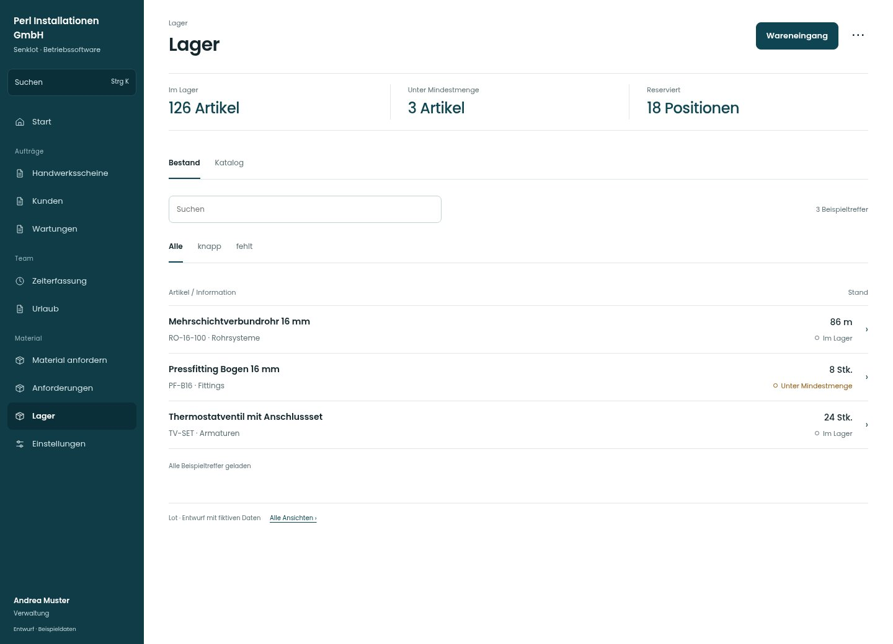

# Lager

[Zur Übersicht](../README.md) · [Bereich: Lager](../bereiche/lager.md)

**Lager · Verwaltung · /lager**

Gestaltungsentwurf mit fiktiven Beispieldaten. Aktionen und Datenänderungen sind lokal simuliert, ohne Backend.

[Desktop](../bilder/071-lager-desktop.jpg) · [Tablet](../bilder/071-lager-tablet.jpg) · [Mobil](../bilder/071-lager-mobil.jpg)

## Aufbau

Bestand, reserviert und frei eindeutig benennen; Wareneingang bleibt Hauptaktion, Inventur und Import getrennte Vorgänge.

## Vorhandene Funktionen für die spätere Umsetzung erhalten

- Bestand/frei/reserviert getrennt
- Knapp-Filter
- Buchungen mit Grund/Bezug
- Einkaufspreise nur mit Recht

## Register und Filter

- Bestand → [lager](lager.md)
- Katalog → [katalog](katalog.md)

## Aktionen

- Wareneingang
- Inventur
- Katalog einspielen

## Quellen

Quellstand: `3e49090`.
- [src/features/orders/StockView.tsx](https://github.com/juliandeutsch22/Prototype-App-Installateure/blob/3e49090d4054ebbd3ecbce6ab583bb944c2c0770/src/features/orders/StockView.tsx)

Die Screens zeigen die vorgesehenen Bedienwege. Reale Speicherung, vollständige Rollenprüfung, Berechnungen, Exporte, Benachrichtigungen und Integrationen müssen bei einer Umsetzung gegen die App geprüft werden.
