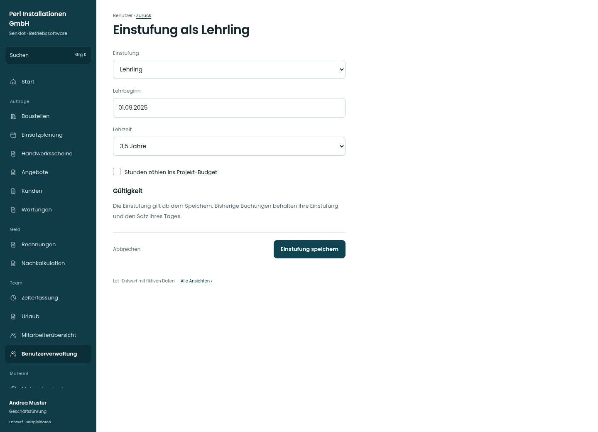

# Einstufung als Lehrling

[Zur Übersicht](../README.md) · [Bereich: Benutzer](../bereiche/benutzer.md)

**Benutzer · Geschäftsführung · /user-mgmt/:uid · Einstufung als Lehrling**

Gestaltungsentwurf mit fiktiven Beispieldaten. Aktionen und Datenänderungen sind lokal simuliert, ohne Backend.

[Desktop](../bilder/197-lehrling-einstufung-desktop.jpg) · [Tablet](../bilder/197-lehrling-einstufung-tablet.jpg) · [Mobil](../bilder/197-lehrling-einstufung-mobil.jpg)

## Aufbau

Lehrbeginn, Lehrzeit und Budgetzählung zusammenhalten; historische Buchungen behalten ihre Tageswerte.

## Vorhandene Funktionen für die spätere Umsetzung erhalten

- Lehrbeginn kann vor Eintritt liegen
- Budgetzählung je Person
- Historische Stundensätze bleiben
- Keine Rollenrechte aus Einstufung ableiten

## Felder im Beispiel

- Einstufung
- Lehrbeginn
- Lehrzeit
- Stunden zählen ins Projekt-Budget

## Aktionen

- Einstufung speichern

## Quellen

Quellstand: `3e49090`.
- [src/features/users/EinstufungFelder.tsx](https://github.com/juliandeutsch22/Prototype-App-Installateure/blob/3e49090d4054ebbd3ecbce6ab583bb944c2c0770/src/features/users/EinstufungFelder.tsx)

Die Screens zeigen die vorgesehenen Bedienwege. Reale Speicherung, vollständige Rollenprüfung, Berechnungen, Exporte, Benachrichtigungen und Integrationen müssen bei einer Umsetzung gegen die App geprüft werden.
