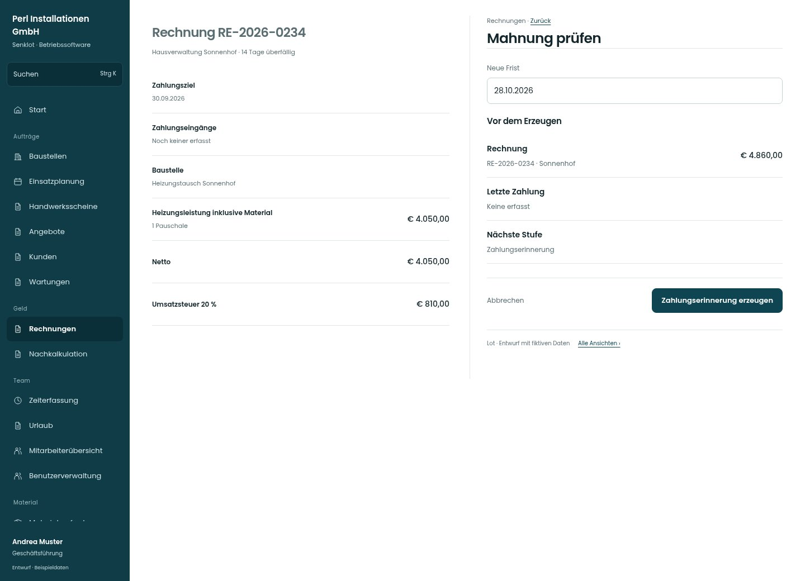

# Mahnung prüfen

[Zur Übersicht](../README.md) · [Bereich: Rechnungen](../bereiche/rechnungen.md)

**Rechnungen · Geschäftsführung · /invoices · Einzelmahnung**

Gestaltungsentwurf mit fiktiven Beispieldaten. Aktionen und Datenänderungen sind lokal simuliert, ohne Backend.

[Desktop](../bilder/091-mahnen-desktop.jpg) · [Tablet](../bilder/091-mahnen-tablet.jpg) · [Mobil](../bilder/091-mahnen-mobil.jpg)

## Aufbau

Letzte Zahlung, nächste Stufe und neue Frist stehen vor der bewussten Erzeugung; bestehende Spesen-/Zinsregeln erhalten.

## Vorhandene Funktionen für die spätere Umsetzung erhalten

- Mahnspesen/Zinsen/Privatkunde-Firma
- Archiviertes Mahn-PDF
- Bewusste Erzeugung

## Felder im Beispiel

- Neue Frist

## Aktionen

- Zahlungserinnerung erzeugen

## Quellen

Quellstand: `3e49090`.
- [src/features/invoices/InvoicesView.tsx](https://github.com/juliandeutsch22/Prototype-App-Installateure/blob/3e49090d4054ebbd3ecbce6ab583bb944c2c0770/src/features/invoices/InvoicesView.tsx)

Die Screens zeigen die vorgesehenen Bedienwege. Reale Speicherung, vollständige Rollenprüfung, Berechnungen, Exporte, Benachrichtigungen und Integrationen müssen bei einer Umsetzung gegen die App geprüft werden.
