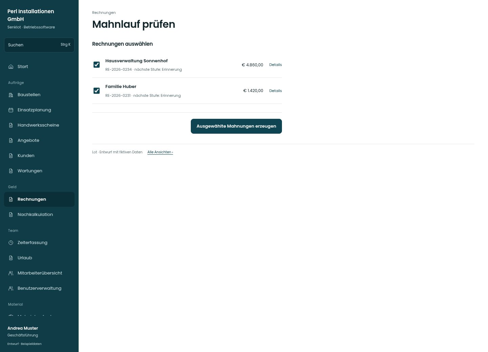

# Mahnlauf prüfen

[Zur Übersicht](../README.md) · [Bereich: Rechnungen](../bereiche/rechnungen.md)

**Rechnungen · Geschäftsführung · /invoices · Mahnlauf**

Gestaltungsentwurf mit fiktiven Beispieldaten. Aktionen und Datenänderungen sind lokal simuliert, ohne Backend.

[Desktop](../bilder/092-mahnlauf-desktop.jpg) · [Tablet](../bilder/092-mahnlauf-tablet.jpg) · [Mobil](../bilder/092-mahnlauf-mobil.jpg)

## Aufbau

Die ausdrücklich ausgewählten Rechnungen müssen als Auswahl sichtbar sein; Detailprüfung und Teilfehler bleiben je Rechnung möglich.

## Vorhandene Funktionen für die spätere Umsetzung erhalten

- Einzeln auswählbar
- Teilfehler pro Rechnung
- Wiederholung erzeugt keine Doppelmahnung

## Aktionen

- Ausgewählte Mahnungen erzeugen

## Quellen

Quellstand: `3e49090`.
- [src/features/invoices/InvoicesView.tsx](https://github.com/juliandeutsch22/Prototype-App-Installateure/blob/3e49090d4054ebbd3ecbce6ab583bb944c2c0770/src/features/invoices/InvoicesView.tsx)
- [src/features/invoices/mahnlauf.ts](https://github.com/juliandeutsch22/Prototype-App-Installateure/blob/3e49090d4054ebbd3ecbce6ab583bb944c2c0770/src/features/invoices/mahnlauf.ts)

Die Screens zeigen die vorgesehenen Bedienwege. Reale Speicherung, vollständige Rollenprüfung, Berechnungen, Exporte, Benachrichtigungen und Integrationen müssen bei einer Umsetzung gegen die App geprüft werden.
