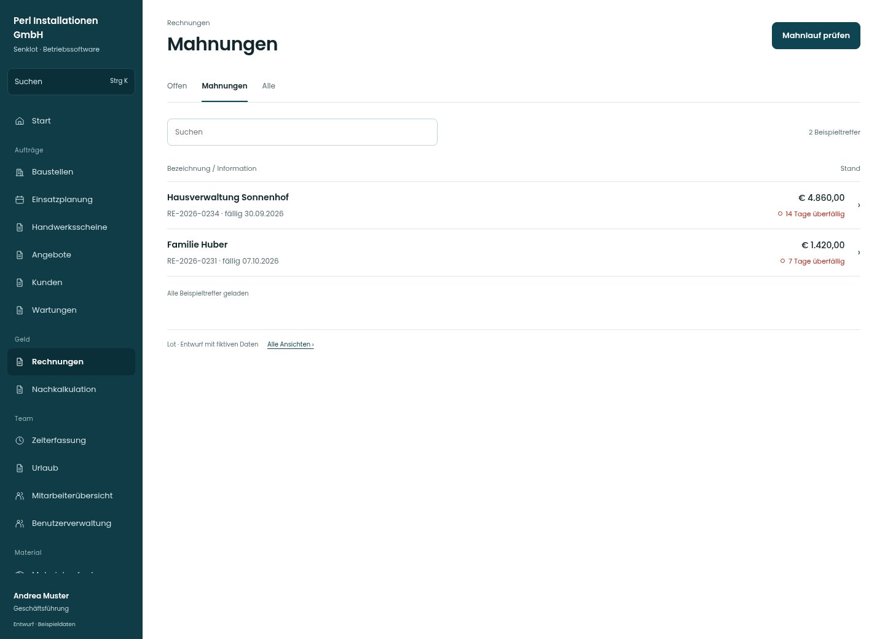

# Mahnungen

[Zur Übersicht](../README.md) · [Bereich: Rechnungen](../bereiche/rechnungen.md)

**Rechnungen · Geschäftsführung · /invoices · Mahnungen**

Gestaltungsentwurf mit fiktiven Beispieldaten. Aktionen und Datenänderungen sind lokal simuliert, ohne Backend.

[Desktop](../bilder/090-mahnungen-desktop.jpg) · [Tablet](../bilder/090-mahnungen-tablet.jpg) · [Mobil](../bilder/090-mahnungen-mobil.jpg)

## Aufbau

Fälligkeit und Stand überblickbar halten; vergangenes Datum allein löst keine Mahnung aus.

## Vorhandene Funktionen für die spätere Umsetzung erhalten

- Keine automatische Mahnung allein durch Datum
- Zahlung/Frist prüfen
- Nächste Mahnstufe je Rechnung

## Register und Filter

- Offen → [rechnungen](rechnungen.md)
- Mahnungen → [mahnungen](mahnungen.md)
- Alle → [rechnungen](rechnungen.md)

## Aktionen

- Mahnlauf prüfen

## Quellen

Quellstand: `3e49090`.
- [src/features/invoices/InvoicesView.tsx](https://github.com/juliandeutsch22/Prototype-App-Installateure/blob/3e49090d4054ebbd3ecbce6ab583bb944c2c0770/src/features/invoices/InvoicesView.tsx)

Die Screens zeigen die vorgesehenen Bedienwege. Reale Speicherung, vollständige Rollenprüfung, Berechnungen, Exporte, Benachrichtigungen und Integrationen müssen bei einer Umsetzung gegen die App geprüft werden.
