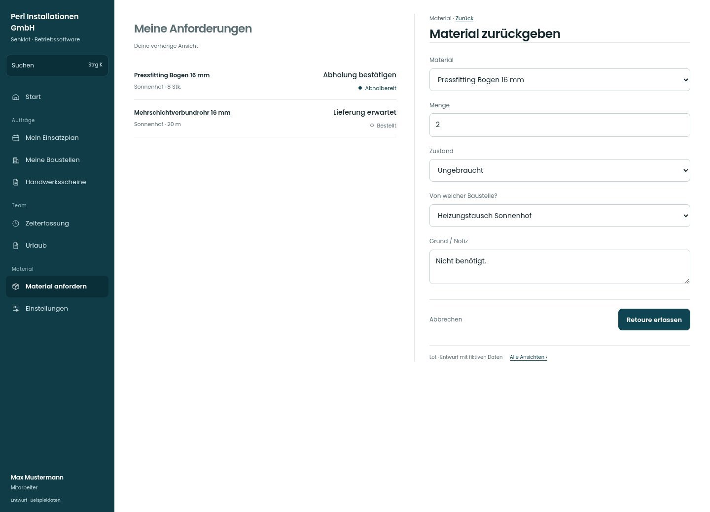

# Material zurückgeben

[Zur Übersicht](../README.md) · [Bereich: Material](../bereiche/material.md)

**Material · Mitarbeiter · /material · Retoure**

Gestaltungsentwurf mit fiktiven Beispieldaten. Aktionen und Datenänderungen sind lokal simuliert, ohne Backend.

[Desktop](../bilder/061-material-retoure-desktop.jpg) · [Tablet](../bilder/061-material-retoure-tablet.jpg) · [Mobil](../bilder/061-material-retoure-mobil.jpg)

## Aufbau

Menge, Zustand und Baustellenbezug bilden eine übersichtliche Eingabe; Rückgabe ist noch keine freigegebene Lagerware.

## Vorhandene Funktionen für die spätere Umsetzung erhalten

- Menge/Zustand
- Keine automatische Lagerfreigabe vor Prüfung

## Felder im Beispiel

- Material
- Menge
- Zustand
- Von welcher Baustelle?
- Grund / Notiz

## Aktionen

- Retoure erfassen

## Quellen

Quellstand: `3e49090`.
- [src/features/orders/OrderView.tsx](https://github.com/juliandeutsch22/Prototype-App-Installateure/blob/3e49090d4054ebbd3ecbce6ab583bb944c2c0770/src/features/orders/OrderView.tsx)

Die Screens zeigen die vorgesehenen Bedienwege. Reale Speicherung, vollständige Rollenprüfung, Berechnungen, Exporte, Benachrichtigungen und Integrationen müssen bei einer Umsetzung gegen die App geprüft werden.
