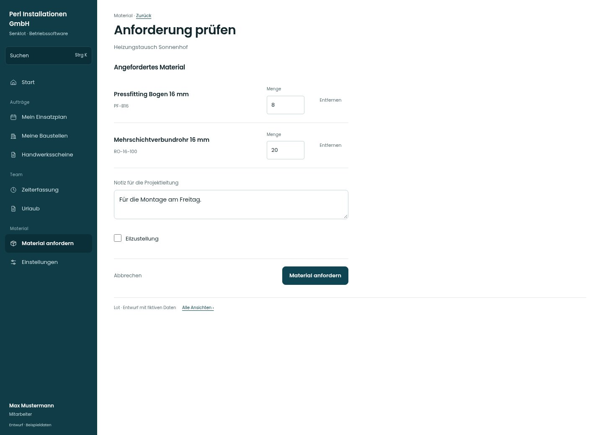

# Anforderung prüfen

[Zur Übersicht](../README.md) · [Bereich: Material](../bereiche/material.md)

**Material · Mitarbeiter · /material · Warenkorb**

Gestaltungsentwurf mit fiktiven Beispieldaten. Aktionen und Datenänderungen sind lokal simuliert, ohne Backend.

[Desktop](../bilder/058-material-warenkorb-desktop.jpg) · [Tablet](../bilder/058-material-warenkorb-tablet.jpg) · [Mobil](../bilder/058-material-warenkorb-mobil.jpg)

## Aufbau

Positionen vor dem Absenden bearbeiten und entfernen können; Notiz und Eilzustellung stehen beim vollständigen Auftrag.

## Vorhandene Funktionen für die spätere Umsetzung erhalten

- Bearbeiten/Entfernen im Warenkorb
- Keine Einkaufspreise ohne Recht
- Fachlicher Status erst nach erfolgreichem Absenden

## Felder im Beispiel

- Notiz für die Projektleitung
- Eilzustellung

## Aktionen

- Material anfordern

## Quellen

Quellstand: `3e49090`.
- [src/features/orders/OrderView.tsx](https://github.com/juliandeutsch22/Prototype-App-Installateure/blob/3e49090d4054ebbd3ecbce6ab583bb944c2c0770/src/features/orders/OrderView.tsx)

Die Screens zeigen die vorgesehenen Bedienwege. Reale Speicherung, vollständige Rollenprüfung, Berechnungen, Exporte, Benachrichtigungen und Integrationen müssen bei einer Umsetzung gegen die App geprüft werden.
