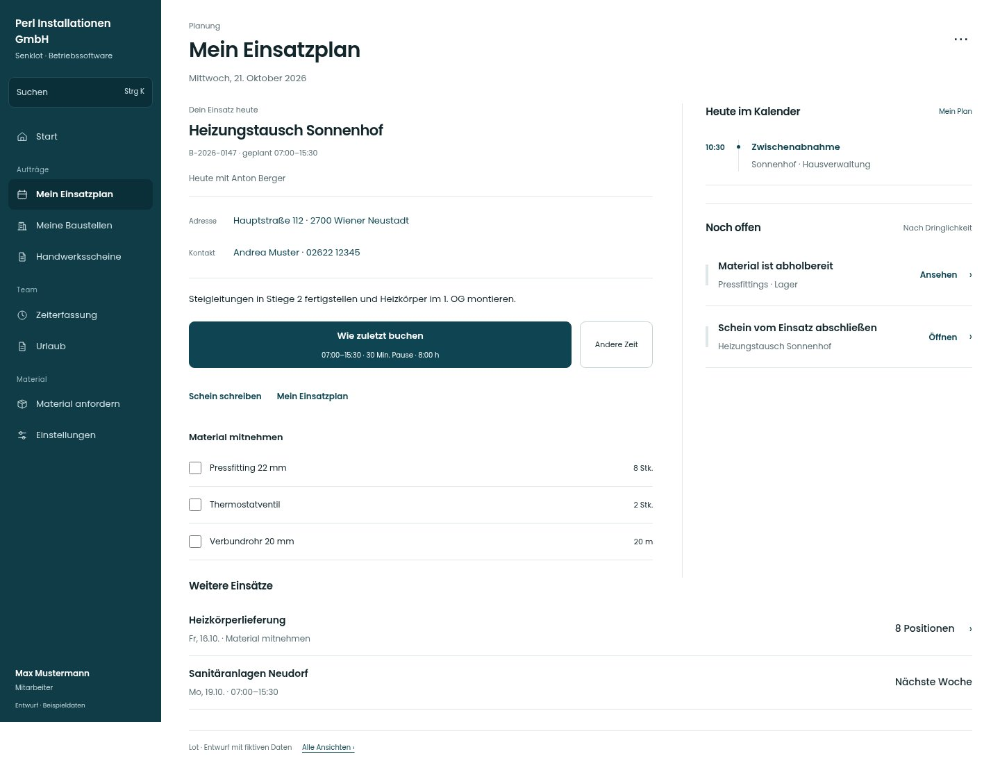

# Mein Einsatzplan

[Zur Übersicht](../README.md) · [Bereich: Planung](../bereiche/planung.md)

**Planung · Mitarbeiter · /my-schedule/mein**

Gestaltungsentwurf mit fiktiven Beispieldaten. Aktionen und Datenänderungen sind lokal simuliert, ohne Backend.

[Desktop](../bilder/046-mein-plan-desktop.jpg) · [Tablet](../bilder/046-mein-plan-tablet.jpg) · [Mobil](../bilder/046-mein-plan-mobil.jpg)

## Aufbau

Eigene Einsätze, Adresse und zugehörige Termine als Tagesfolge zeigen; Zeit, Schein, Plan und Material bleiben direkt erreichbar.

## Vorhandene Funktionen für die spätere Umsetzung erhalten

- Vergangene/nächste Einsätze und Termine
- Kalender nur nach Betriebsschalter
- Projektleitung nur wenn einplanbar freigegeben

## Aktionen

- Zeit erfassen
- Team-Woche
- Kalender abonnieren

## Quellen

Quellstand: `3e49090`.
- [src/features/assignments/MyScheduleView.tsx](https://github.com/juliandeutsch22/Prototype-App-Installateure/blob/3e49090d4054ebbd3ecbce6ab583bb944c2c0770/src/features/assignments/MyScheduleView.tsx)

Die Screens zeigen die vorgesehenen Bedienwege. Reale Speicherung, vollständige Rollenprüfung, Berechnungen, Exporte, Benachrichtigungen und Integrationen müssen bei einer Umsetzung gegen die App geprüft werden.
