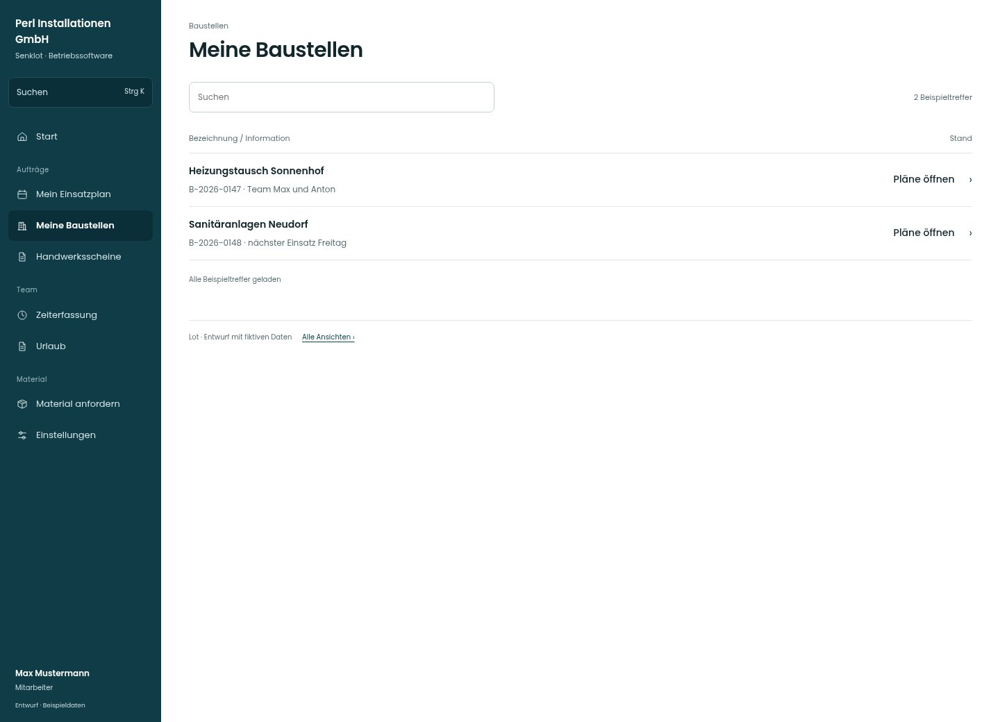

# Meine Baustellen

[Zur Übersicht](../README.md) · [Bereich: Baustellen](../bereiche/baustellen.md)

**Baustellen · Mitarbeiter · /my-projects**

Gestaltungsentwurf mit fiktiven Beispieldaten. Aktionen und Datenänderungen sind lokal simuliert, ohne Backend.

[Desktop](../bilder/036-meine-baustellen-desktop.jpg) · [Tablet](../bilder/036-meine-baustellen-tablet.jpg) · [Mobil](../bilder/036-meine-baustellen-mobil.jpg)

## Aufbau

Einsatzrelevante Baustellen und freigegebene Pläne vorn; keine administrativen Stammdaten- oder Margenaktionen für Monteure.

## Vorhandene Funktionen für die spätere Umsetzung erhalten

- Teamzuordnung und Einteilung
- Keine administrativen Stammdaten-/Margenaktionen
- Kontakt vor Ort
- Pläne

## Quellen

Quellstand: `3e49090`.
- [src/features/projects/MyProjectsView.tsx](https://github.com/juliandeutsch22/Prototype-App-Installateure/blob/3e49090d4054ebbd3ecbce6ab583bb944c2c0770/src/features/projects/MyProjectsView.tsx)
- [src/features/projects/PlaeneListe.tsx](https://github.com/juliandeutsch22/Prototype-App-Installateure/blob/3e49090d4054ebbd3ecbce6ab583bb944c2c0770/src/features/projects/PlaeneListe.tsx)

Die Screens zeigen die vorgesehenen Bedienwege. Reale Speicherung, vollständige Rollenprüfung, Berechnungen, Exporte, Benachrichtigungen und Integrationen müssen bei einer Umsetzung gegen die App geprüft werden.
