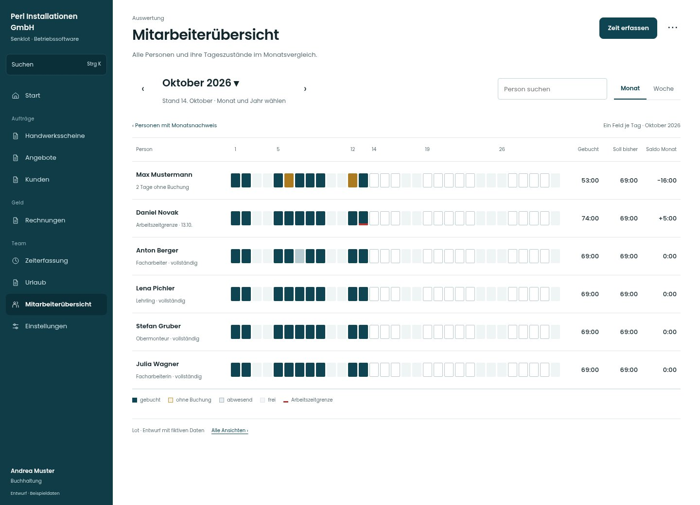

# Gemeinsamer Monatsvergleich

[Zur Übersicht](../README.md) · [Bereich: Auswertung](../bereiche/auswertung.md)

**Auswertung · Buchhaltung · /accounting**

Gestaltungsentwurf mit fiktiven Beispieldaten. Aktionen und Datenänderungen sind lokal simuliert, ohne Backend.

[Desktop](../bilder/214-mitarbeiter-monatsraster-desktop.jpg) · [Tablet](../bilder/214-mitarbeiter-monatsraster-tablet.jpg) · [Mobil](../bilder/214-mitarbeiter-monatsraster-mobil.jpg)

## Aufbau

Bedingten Arbeitszustand bzw. getrennte Aufgabe explizit zeigen, ohne vorhandene Ansicht umzudeuten.

## Vorhandene Funktionen für die spätere Umsetzung erhalten

- Ist/Soll/Saldo getrennt
- Fehlende Tage/Arbeitszeitgrenzen
- Zeitkonto nur für berechtigte Personen
- Kein Zeitkonto für Administration
- Support ohne sensible Tagesdetails

## Register und Filter

- Monat → [mitarbeiter-monat](mitarbeiter-monat.md)
- Woche → [mitarbeiter-woche](mitarbeiter-woche.md)

## Aktionen

- Bericht exportieren
- Stunden je Baustelle

## Quellen

Quellstand: `3e49090`.
- [src/features/accounting/AccountingView.tsx](https://github.com/juliandeutsch22/Prototype-App-Installateure/blob/3e49090d4054ebbd3ecbce6ab583bb944c2c0770/src/features/accounting/AccountingView.tsx)
- [src/features/accounting/UebersichtListe.tsx](https://github.com/juliandeutsch22/Prototype-App-Installateure/blob/3e49090d4054ebbd3ecbce6ab583bb944c2c0770/src/features/accounting/UebersichtListe.tsx)
- [src/features/accounting/Streifen.tsx](https://github.com/juliandeutsch22/Prototype-App-Installateure/blob/3e49090d4054ebbd3ecbce6ab583bb944c2c0770/src/features/accounting/Streifen.tsx)

Die Screens zeigen die vorgesehenen Bedienwege. Reale Speicherung, vollständige Rollenprüfung, Berechnungen, Exporte, Benachrichtigungen und Integrationen müssen bei einer Umsetzung gegen die App geprüft werden.
