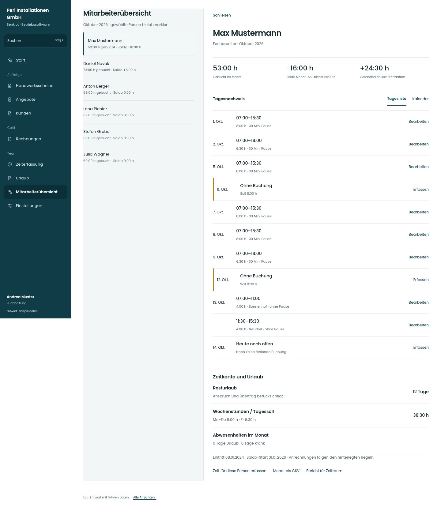

# Max Mustermann

[Zur Übersicht](../README.md) · [Bereich: Auswertung](../bereiche/auswertung.md)

**Auswertung · Buchhaltung · /accounting · Person**

Gestaltungsentwurf mit fiktiven Beispieldaten. Aktionen und Datenänderungen sind lokal simuliert, ohne Backend.

[Desktop](../bilder/121-mitarbeiter-person-desktop.jpg) · [Tablet](../bilder/121-mitarbeiter-person-tablet.jpg) · [Mobil](../bilder/121-mitarbeiter-person-mobil.jpg)

## Aufbau

Tagesliste mit allen Buchungen zuerst, Gesamtsaldo und Urlaub klar getrennt; Kalender als alternative Detailansicht erhalten.

## Vorhandene Funktionen für die spätere Umsetzung erhalten

- Gesamtsaldo vs Monatssaldo
- Arbeitszeitgrenzen
- Unterricht/Jugendliche
- Fremdkorrektur mit Vermerk

## Aktionen

- Zeit für Person erfassen
- Monat als CSV
- Bericht für Zeitraum
- Arbeitszeitgrenzen

## Quellen

Quellstand: `3e49090`.
- [src/features/accounting/PersonFenster.tsx](https://github.com/juliandeutsch22/Prototype-App-Installateure/blob/3e49090d4054ebbd3ecbce6ab583bb944c2c0770/src/features/accounting/PersonFenster.tsx)
- [src/features/accounting/Gesamtsaldo.tsx](https://github.com/juliandeutsch22/Prototype-App-Installateure/blob/3e49090d4054ebbd3ecbce6ab583bb944c2c0770/src/features/accounting/Gesamtsaldo.tsx)
- [src/features/accounting/ArbeitszeitGrenzenKarte.tsx](https://github.com/juliandeutsch22/Prototype-App-Installateure/blob/3e49090d4054ebbd3ecbce6ab583bb944c2c0770/src/features/accounting/ArbeitszeitGrenzenKarte.tsx)

Die Screens zeigen die vorgesehenen Bedienwege. Reale Speicherung, vollständige Rollenprüfung, Berechnungen, Exporte, Benachrichtigungen und Integrationen müssen bei einer Umsetzung gegen die App geprüft werden.
