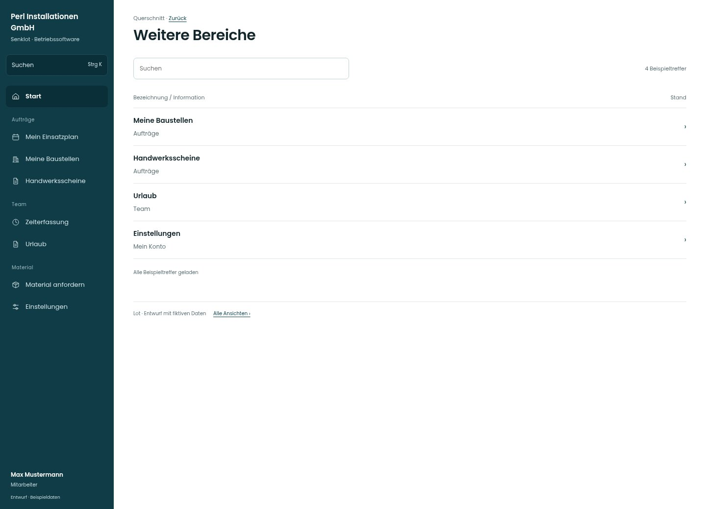

# Weitere Bereiche

[Zur Übersicht](../README.md) · [Bereich: Querschnitt](../bereiche/querschnitt.md)

**Querschnitt · Mitarbeiter · Meldungsfenster**

Gestaltungsentwurf mit fiktiven Beispieldaten. Aktionen und Datenänderungen sind lokal simuliert, ohne Backend.

[Desktop](../bilder/261-mobil-mehr-desktop.jpg) · [Tablet](../bilder/261-mobil-mehr-tablet.jpg) · [Mobil](../bilder/261-mobil-mehr-mobil.jpg)

## Aufbau

Empfängerbezug und konkretes Ziel erhalten; keine fremden Meldungen oder unzulässigen Zielrouten einführen.

## Vorhandene Funktionen für die spätere Umsetzung erhalten

- Rollen-/Empfängerbezug
- Nur verfügbare Zielroute
- Gelesen-Zustand wie Bestand

## Quellen

Quellstand: `3e49090`.
- [src/app/Layout.tsx](https://github.com/juliandeutsch22/Prototype-App-Installateure/blob/3e49090d4054ebbd3ecbce6ab583bb944c2c0770/src/app/Layout.tsx)

Die Screens zeigen die vorgesehenen Bedienwege. Reale Speicherung, vollständige Rollenprüfung, Berechnungen, Exporte, Benachrichtigungen und Integrationen müssen bei einer Umsetzung gegen die App geprüft werden.
