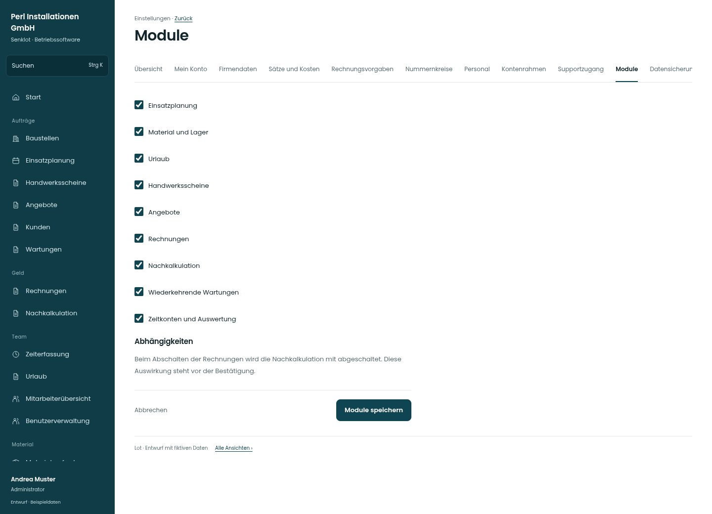

# Module

[Zur Übersicht](../README.md) · [Bereich: Einstellungen](../bereiche/einstellungen.md)

**Einstellungen · Administrator · /settings/module**

Gestaltungsentwurf mit fiktiven Beispieldaten. Aktionen und Datenänderungen sind lokal simuliert, ohne Backend.

[Desktop](../bilder/152-module-desktop.jpg) · [Tablet](../bilder/152-module-tablet.jpg) · [Mobil](../bilder/152-module-mobil.jpg)

## Aufbau

Klare Modulliste mit Abhängigkeiten vor Speichern; Modulwahl ersetzt weder Berechtigung noch fachliche Freigabe.

## Vorhandene Funktionen für die spätere Umsetzung erhalten

- Nur Administrator
- Kern nicht abschaltbar
- Abhängige Module vorab nennen
- Kein Ersatz für Rechteverwaltung

## Register und Filter

- Übersicht → [einstellungen](einstellungen.md)
- Mein Konto → [konto](konto.md)
- Firmendaten → [firma](firma.md)
- Sätze und Kosten → [saetze](saetze.md)
- Rechnungsvorgaben → [rechnungsvorgaben](rechnungsvorgaben.md)
- Nummernkreise → [nummern](nummern.md)
- Personal → [personal](personal.md)
- Kontenrahmen → [kontenrahmen](kontenrahmen.md)
- Supportzugang → [support](support.md)
- Module → [module](module.md)
- Datensicherung → [sicherung](sicherung.md)

## Felder im Beispiel

- Einsatzplanung
- Material und Lager
- Urlaub
- Handwerksscheine
- Angebote
- Rechnungen
- Nachkalkulation
- Wiederkehrende Wartungen
- Zeitkonten und Auswertung

## Aktionen

- Module speichern

## Quellen

Quellstand: `3e49090`.
- [src/features/modules/ModulesView.tsx](https://github.com/juliandeutsch22/Prototype-App-Installateure/blob/3e49090d4054ebbd3ecbce6ab583bb944c2c0770/src/features/modules/ModulesView.tsx)

Die Screens zeigen die vorgesehenen Bedienwege. Reale Speicherung, vollständige Rollenprüfung, Berechnungen, Exporte, Benachrichtigungen und Integrationen müssen bei einer Umsetzung gegen die App geprüft werden.
