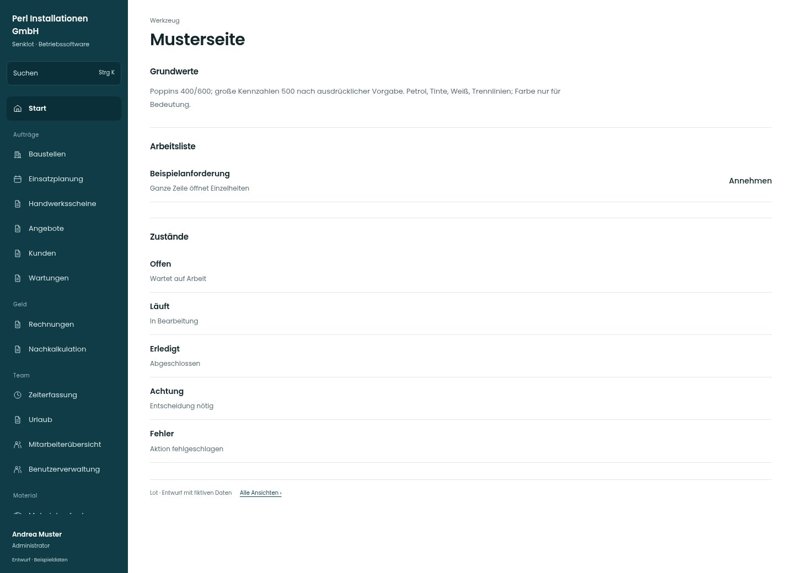

# Musterseite

[Zur Übersicht](../README.md) · [Bereich: Werkzeug](../bereiche/werkzeug.md)

**Werkzeug · Administrator · /_muster**

Gestaltungsentwurf mit fiktiven Beispieldaten. Aktionen und Datenänderungen sind lokal simuliert, ohne Backend.

[Desktop](../bilder/184-muster-desktop.jpg) · [Tablet](../bilder/184-muster-tablet.jpg) · [Mobil](../bilder/184-muster-mobil.jpg)

## Aufbau

Gemeinsame Schrift-, Aktions- und Zustandsregeln als Werkzeug zeigen; keine zusätzliche betriebliche Funktion daraus machen.

## Vorhandene Funktionen für die spätere Umsetzung erhalten

- Werkzeug ohne betrieblichen Menüpunkt
- Keine Wirkung auf den Betrieb

## Quellen

Quellstand: `3e49090`.
- [src/features/muster/MusterView.tsx](https://github.com/juliandeutsch22/Prototype-App-Installateure/blob/3e49090d4054ebbd3ecbce6ab583bb944c2c0770/src/features/muster/MusterView.tsx)
- [src/features/muster/MusterPlanung.tsx](https://github.com/juliandeutsch22/Prototype-App-Installateure/blob/3e49090d4054ebbd3ecbce6ab583bb944c2c0770/src/features/muster/MusterPlanung.tsx)
- [src/features/muster/MusterMonat.tsx](https://github.com/juliandeutsch22/Prototype-App-Installateure/blob/3e49090d4054ebbd3ecbce6ab583bb944c2c0770/src/features/muster/MusterMonat.tsx)
- [src/features/muster/MusterUebersicht.tsx](https://github.com/juliandeutsch22/Prototype-App-Installateure/blob/3e49090d4054ebbd3ecbce6ab583bb944c2c0770/src/features/muster/MusterUebersicht.tsx)

Die Screens zeigen die vorgesehenen Bedienwege. Reale Speicherung, vollständige Rollenprüfung, Berechnungen, Exporte, Benachrichtigungen und Integrationen müssen bei einer Umsetzung gegen die App geprüft werden.
