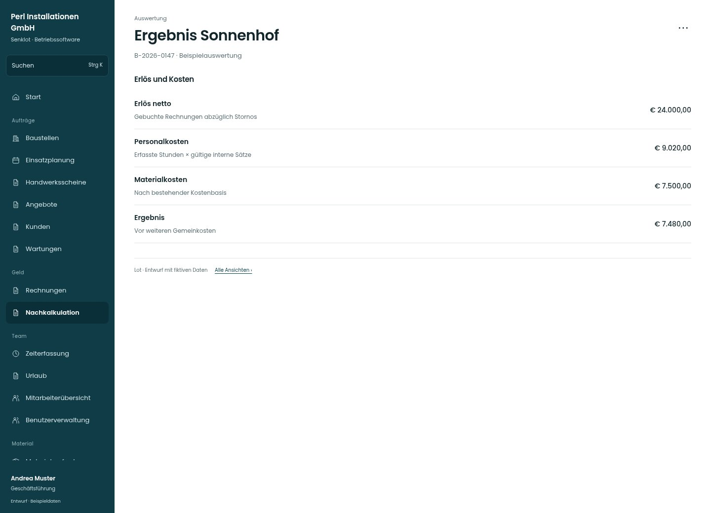

# Ergebnis Sonnenhof

[Zur Übersicht](../README.md) · [Bereich: Auswertung](../bereiche/auswertung.md)

**Auswertung · Geschäftsführung · /costing · Baustelle**

Gestaltungsentwurf mit fiktiven Beispieldaten. Aktionen und Datenänderungen sind lokal simuliert, ohne Backend.

[Desktop](../bilder/125-nachkalkulation-detail-desktop.jpg) · [Tablet](../bilder/125-nachkalkulation-detail-tablet.jpg) · [Mobil](../bilder/125-nachkalkulation-detail-mobil.jpg)

## Aufbau

Erlös, Personalkosten, Material und Ergebnis als nachvollziehbare Zeilen erhalten; bestehende Kostenhistorie maßgeblich lassen.

## Vorhandene Funktionen für die spätere Umsetzung erhalten

- Kostenhistorie und Datenqualität
- Keine neue Kalkulation
- Helferstunden/Budget zählen wie bisher

## Aktionen

- Kostensätze prüfen

## Quellen

Quellstand: `3e49090`.
- [src/features/costing/NachkalkulationView.tsx](https://github.com/juliandeutsch22/Prototype-App-Installateure/blob/3e49090d4054ebbd3ecbce6ab583bb944c2c0770/src/features/costing/NachkalkulationView.tsx)

Die Screens zeigen die vorgesehenen Bedienwege. Reale Speicherung, vollständige Rollenprüfung, Berechnungen, Exporte, Benachrichtigungen und Integrationen müssen bei einer Umsetzung gegen die App geprüft werden.
