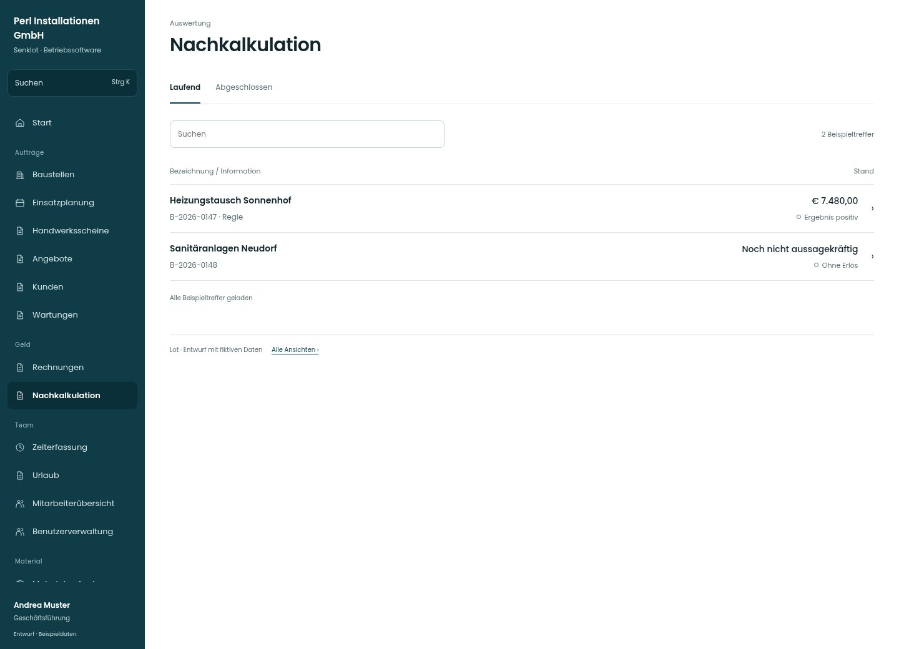

# Nachkalkulation

[Zur Übersicht](../README.md) · [Bereich: Auswertung](../bereiche/auswertung.md)

**Auswertung · Geschäftsführung · /costing**

Gestaltungsentwurf mit fiktiven Beispieldaten. Aktionen und Datenänderungen sind lokal simuliert, ohne Backend.

[Desktop](../bilder/124-nachkalkulation-desktop.jpg) · [Tablet](../bilder/124-nachkalkulation-tablet.jpg) · [Mobil](../bilder/124-nachkalkulation-mobil.jpg)

## Aufbau

Ergebnis und Datenqualität zusammen lesen; ohne Erlös oder Kostensätze keine scheinpräzise Marge darstellen.

## Vorhandene Funktionen für die spätere Umsetzung erhalten

- Nur Spitze
- Kostensätze fehlen sichtbar
- Mit Verlust/zu prüfen/ohne Erlös
- Keine erfundenen Margen bei fehlenden Daten

## Register und Filter

- Laufend → [nachkalkulation](nachkalkulation.md)
- Abgeschlossen → [nachkalkulation-filter-1](nachkalkulation-filter-1.md)

## Quellen

Quellstand: `3e49090`.
- [src/features/costing/NachkalkulationView.tsx](https://github.com/juliandeutsch22/Prototype-App-Installateure/blob/3e49090d4054ebbd3ecbce6ab583bb944c2c0770/src/features/costing/NachkalkulationView.tsx)

Die Screens zeigen die vorgesehenen Bedienwege. Reale Speicherung, vollständige Rollenprüfung, Berechnungen, Exporte, Benachrichtigungen und Integrationen müssen bei einer Umsetzung gegen die App geprüft werden.
