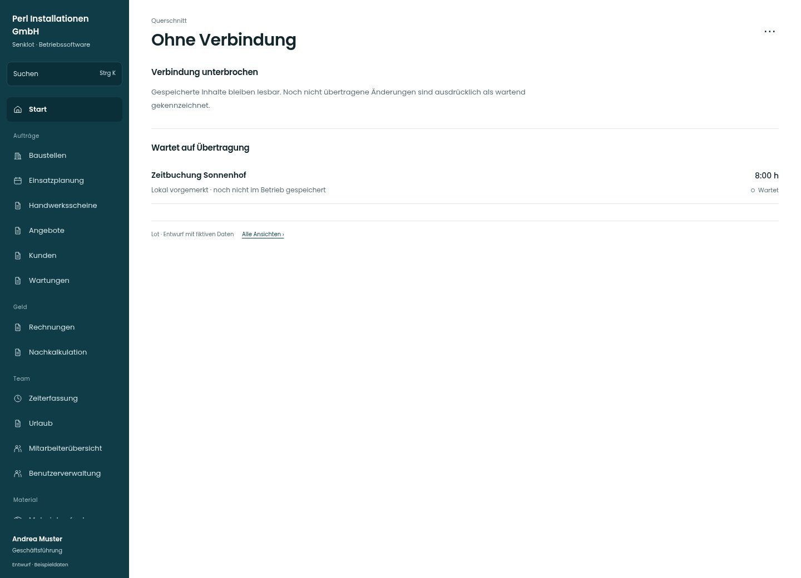

# Ohne Verbindung

[Zur Übersicht](../README.md) · [Bereich: Querschnitt](../bereiche/querschnitt.md)

**Querschnitt · Geschäftsführung · Globale Verbindungsanzeige**

Gestaltungsentwurf mit fiktiven Beispieldaten. Aktionen und Datenänderungen sind lokal simuliert, ohne Backend.

[Desktop](../bilder/166-offline-desktop.jpg) · [Tablet](../bilder/166-offline-tablet.jpg) · [Mobil](../bilder/166-offline-mobil.jpg)

## Aufbau

Gespeicherte Inhalte und wartende Übertragung klar trennen; keine unechte Erfolgsmeldung oder neue Offlinezusage.

## Vorhandene Funktionen für die spätere Umsetzung erhalten

- Nur bestehende Offline-Funktionen
- Konflikt/Übertragung fehlgeschlagen getrennt
- Keine automatische Zusage für neue Uploads

## Aktionen

- Erneut verbinden

## Quellen

Quellstand: `3e49090`.
- [src/components/Verbindungsband.tsx](https://github.com/juliandeutsch22/Prototype-App-Installateure/blob/3e49090d4054ebbd3ecbce6ab583bb944c2c0770/src/components/Verbindungsband.tsx)
- [src/lib/sync/ausgangsfach.ts](https://github.com/juliandeutsch22/Prototype-App-Installateure/blob/3e49090d4054ebbd3ecbce6ab583bb944c2c0770/src/lib/sync/ausgangsfach.ts)

Die Screens zeigen die vorgesehenen Bedienwege. Reale Speicherung, vollständige Rollenprüfung, Berechnungen, Exporte, Benachrichtigungen und Integrationen müssen bei einer Umsetzung gegen die App geprüft werden.
