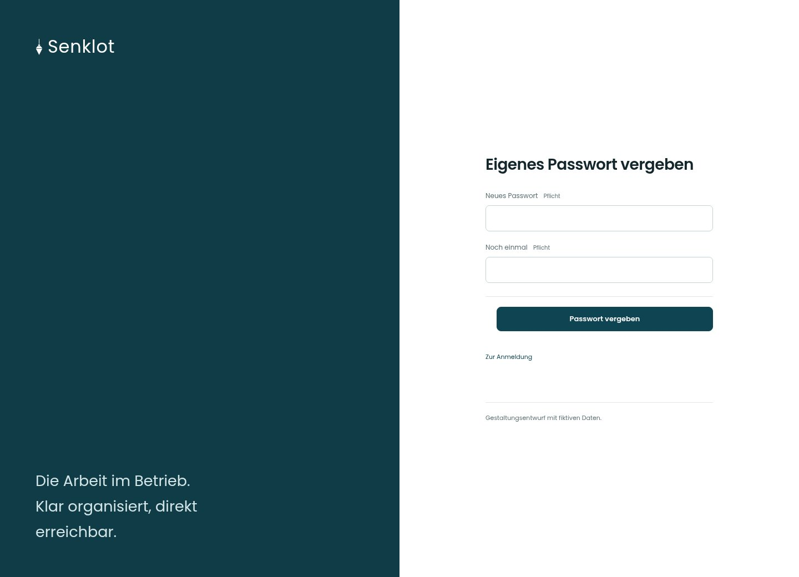

# Eigenes Passwort vergeben

[Zur Übersicht](../README.md) · [Bereich: Zugang](../bereiche/zugang.md)

**Zugang · Geschäftsführung · Nach Rücksetzlink / Startpasswort**

Gestaltungsentwurf mit fiktiven Beispieldaten. Aktionen und Datenänderungen sind lokal simuliert, ohne Backend.

[Desktop](../bilder/003-passwort-setzen-desktop.jpg) · [Tablet](../bilder/003-passwort-setzen-tablet.jpg) · [Mobil](../bilder/003-passwort-setzen-mobil.jpg)

## Aufbau

Neues Passwort und Wiederholung gemeinsam zeigen; die verpflichtende Vergabe braucht keine zusätzliche Statistik oder Navigation.

## Vorhandene Funktionen für die spätere Umsetzung erhalten

- Passwortbestätigung
- Bei normaler Änderung aktuelles Passwort
- Kein Überspringen beim Startpasswort

## Felder im Beispiel

- Neues Passwort (Pflichtfeld)
- Noch einmal (Pflichtfeld)

## Aktionen

- Passwort vergeben
- Zur Anmeldung

## Quellen

Quellstand: `3e49090`.
- [src/features/auth/PasswortAendern.tsx](https://github.com/juliandeutsch22/Prototype-App-Installateure/blob/3e49090d4054ebbd3ecbce6ab583bb944c2c0770/src/features/auth/PasswortAendern.tsx)

Die Screens zeigen die vorgesehenen Bedienwege. Reale Speicherung, vollständige Rollenprüfung, Berechnungen, Exporte, Benachrichtigungen und Integrationen müssen bei einer Umsetzung gegen die App geprüft werden.
