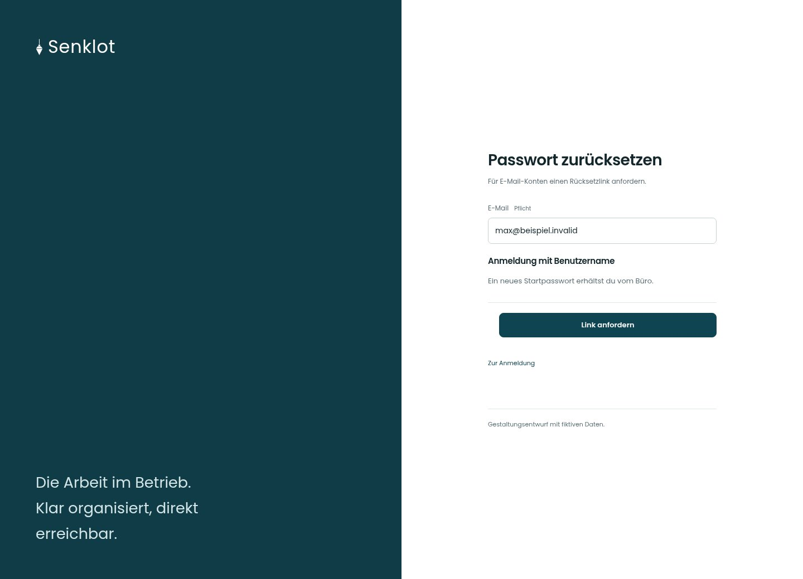

# Passwort zurücksetzen

[Zur Übersicht](../README.md) · [Bereich: Zugang](../bereiche/zugang.md)

**Zugang · Mitarbeiter · /login · Rücksetzmodus**

Gestaltungsentwurf mit fiktiven Beispieldaten. Aktionen und Datenänderungen sind lokal simuliert, ohne Backend.

[Desktop](../bilder/002-passwort-vergessen-desktop.jpg) · [Tablet](../bilder/002-passwort-vergessen-tablet.jpg) · [Mobil](../bilder/002-passwort-vergessen-mobil.jpg)

## Aufbau

E-Mail-Rücksetzung und Startpasswort für Benutzerkonten verständlich trennen, ohne die Existenz eines Kontos zu verraten.

## Vorhandene Funktionen für die spätere Umsetzung erhalten

- Keine Auskunft, ob ein Konto existiert
- Benutzerkonten erhalten keinen Mail-Link

## Felder im Beispiel

- E-Mail (Pflichtfeld)

## Aktionen

- Link anfordern
- Zur Anmeldung

## Quellen

Quellstand: `3e49090`.
- [src/features/auth/LoginPage.tsx](https://github.com/juliandeutsch22/Prototype-App-Installateure/blob/3e49090d4054ebbd3ecbce6ab583bb944c2c0770/src/features/auth/LoginPage.tsx)

Die Screens zeigen die vorgesehenen Bedienwege. Reale Speicherung, vollständige Rollenprüfung, Berechnungen, Exporte, Benachrichtigungen und Integrationen müssen bei einer Umsetzung gegen die App geprüft werden.
