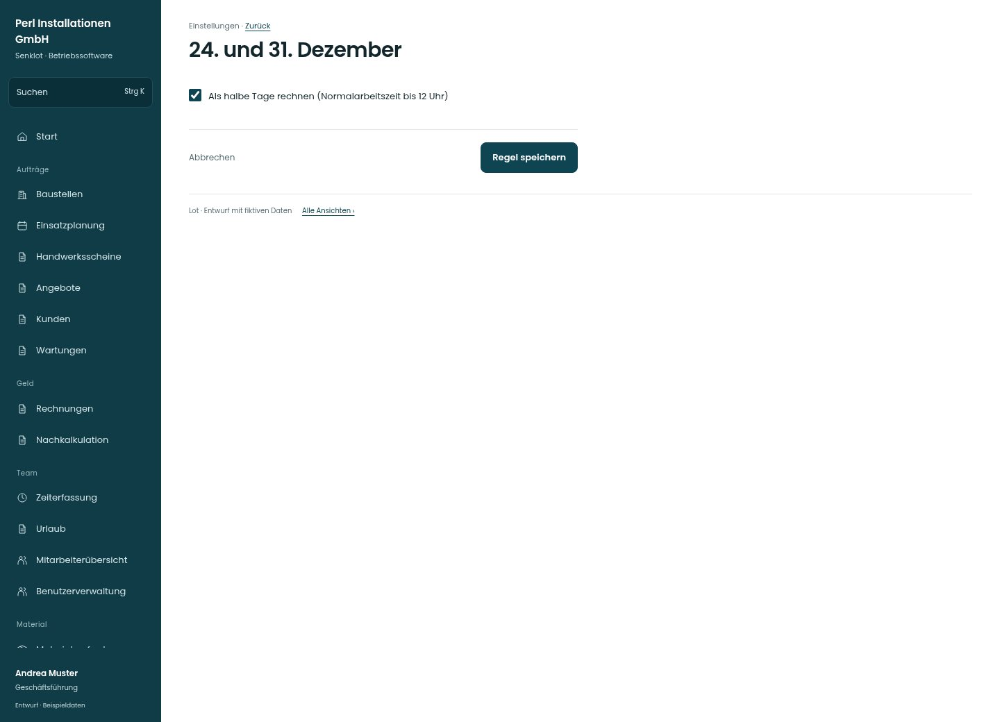

# 24. und 31. Dezember

[Zur Übersicht](../README.md) · [Bereich: Einstellungen](../bereiche/einstellungen.md)

**Einstellungen · Geschäftsführung · /settings/personal · Dezember**

Gestaltungsentwurf mit fiktiven Beispieldaten. Aktionen und Datenänderungen sind lokal simuliert, ohne Backend.

[Desktop](../bilder/148-personal-dezember-desktop.jpg) · [Tablet](../bilder/148-personal-dezember-tablet.jpg) · [Mobil](../bilder/148-personal-dezember-mobil.jpg)

## Aufbau

Eine verständliche Regel genügt; Auswirkungen auf Zeit und Urlaub verwenden denselben bestehenden Schalter.

## Vorhandene Funktionen für die spätere Umsetzung erhalten

- Zeit- und Urlaubsberechnung verwenden dieselbe Regel

## Felder im Beispiel

- Als halbe Tage rechnen (Normalarbeitszeit bis 12 Uhr)

## Aktionen

- Regel speichern

## Quellen

Quellstand: `3e49090`.
- [src/features/settings/SettingsView.tsx](https://github.com/juliandeutsch22/Prototype-App-Installateure/blob/3e49090d4054ebbd3ecbce6ab583bb944c2c0770/src/features/settings/SettingsView.tsx)

Die Screens zeigen die vorgesehenen Bedienwege. Reale Speicherung, vollständige Rollenprüfung, Berechnungen, Exporte, Benachrichtigungen und Integrationen müssen bei einer Umsetzung gegen die App geprüft werden.
