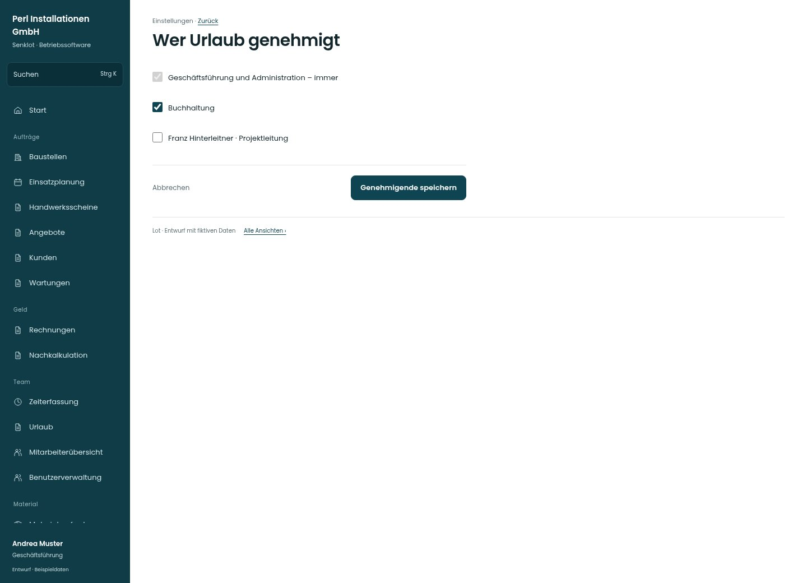

# Wer Urlaub genehmigt

[Zur Übersicht](../README.md) · [Bereich: Einstellungen](../bereiche/einstellungen.md)

**Einstellungen · Geschäftsführung · /settings/personal · Genehmigende**

Gestaltungsentwurf mit fiktiven Beispieldaten. Aktionen und Datenänderungen sind lokal simuliert, ohne Backend.

[Desktop](../bilder/144-personal-genehmiger-desktop.jpg) · [Tablet](../bilder/144-personal-genehmiger-tablet.jpg) · [Mobil](../bilder/144-personal-genehmiger-mobil.jpg)

## Aufbau

Nicht abwählbare Spitze als feste Angabe kennzeichnen; zusätzliche Genehmiger bleiben eine ausdrückliche Auswahl.

## Vorhandene Funktionen für die spätere Umsetzung erhalten

- Spitze nicht abwählbar
- Benutzerbezogene Freigaben
- Unbezahlter Urlaub bleibt Spitze

## Felder im Beispiel

- Geschäftsführung und Administration – immer
- Buchhaltung
- Franz Hinterleitner · Projektleitung

## Aktionen

- Genehmigende speichern

## Quellen

Quellstand: `3e49090`.
- [src/features/settings/SettingsView.tsx](https://github.com/juliandeutsch22/Prototype-App-Installateure/blob/3e49090d4054ebbd3ecbce6ab583bb944c2c0770/src/features/settings/SettingsView.tsx)

Die Screens zeigen die vorgesehenen Bedienwege. Reale Speicherung, vollständige Rollenprüfung, Berechnungen, Exporte, Benachrichtigungen und Integrationen müssen bei einer Umsetzung gegen die App geprüft werden.
