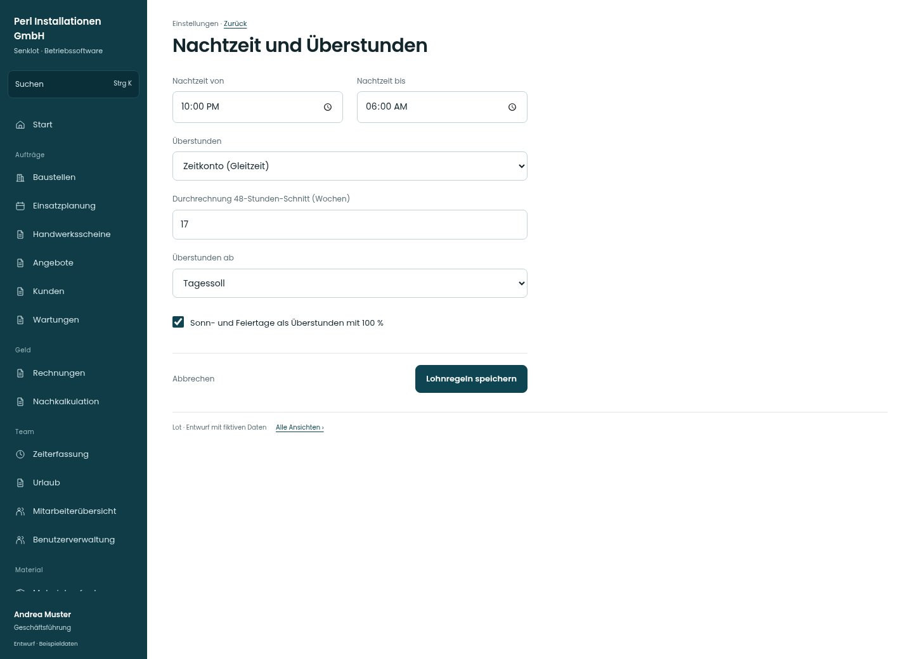

# Nachtzeit und Überstunden

[Zur Übersicht](../README.md) · [Bereich: Einstellungen](../bereiche/einstellungen.md)

**Einstellungen · Geschäftsführung · /settings/personal · Lohnregeln**

Gestaltungsentwurf mit fiktiven Beispieldaten. Aktionen und Datenänderungen sind lokal simuliert, ohne Backend.

[Desktop](../bilder/146-personal-lohn-desktop.jpg) · [Tablet](../bilder/146-personal-lohn-tablet.jpg) · [Mobil](../bilder/146-personal-lohn-mobil.jpg)

## Aufbau

Nachtzeit, Überstunden und Durchrechnung als zusammenhängende Regelabschnitte erhalten; individuelle Sollzeit ist keine neue Zuschlagsgrenze.

## Vorhandene Funktionen für die spätere Umsetzung erhalten

- Bestehende Zuschlagsrechnung
- Jugendliche gesondert
- Keine pauschale Gleichsetzung von Soll und Überstunden

## Felder im Beispiel

- Nachtzeit von
- Nachtzeit bis
- Überstunden
- Durchrechnung 48-Stunden-Schnitt (Wochen)
- Überstunden ab
- Sonn- und Feiertage als Überstunden mit 100 %

## Aktionen

- Lohnregeln speichern

## Quellen

Quellstand: `3e49090`.
- [src/features/settings/LohnregelnKarte.tsx](https://github.com/juliandeutsch22/Prototype-App-Installateure/blob/3e49090d4054ebbd3ecbce6ab583bb944c2c0770/src/features/settings/LohnregelnKarte.tsx)

Die Screens zeigen die vorgesehenen Bedienwege. Reale Speicherung, vollständige Rollenprüfung, Berechnungen, Exporte, Benachrichtigungen und Integrationen müssen bei einer Umsetzung gegen die App geprüft werden.
