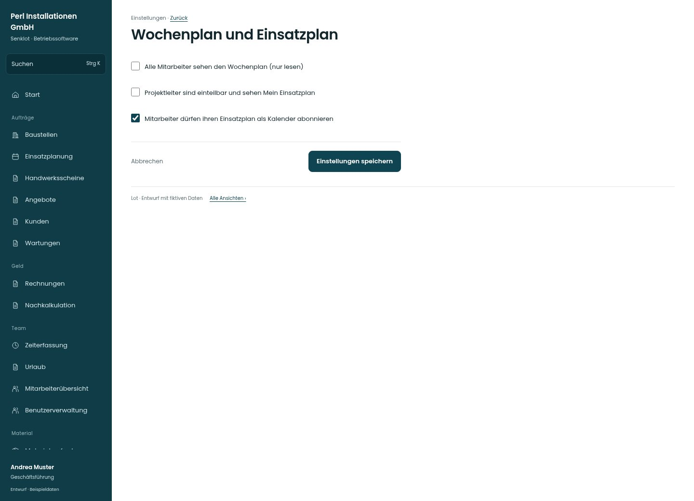

# Wochenplan und Einsatzplan

[Zur Übersicht](../README.md) · [Bereich: Einstellungen](../bereiche/einstellungen.md)

**Einstellungen · Geschäftsführung · /settings/personal · Planung**

Gestaltungsentwurf mit fiktiven Beispieldaten. Aktionen und Datenänderungen sind lokal simuliert, ohne Backend.

[Desktop](../bilder/145-personal-planung-desktop.jpg) · [Tablet](../bilder/145-personal-planung-tablet.jpg) · [Mobil](../bilder/145-personal-planung-mobil.jpg)

## Aufbau

Team-Leserecht, Einplanbarkeit und persönliches Kalenderabo klar benennen; keine neuen Rollenrechte aus bloßer Sichtbarkeit ableiten.

## Vorhandene Funktionen für die spätere Umsetzung erhalten

- Team-Woche ohne Gründe und Schreibaktionen
- Zusatznavigation nur bei Freigabe

## Felder im Beispiel

- Alle Mitarbeiter sehen den Wochenplan (nur lesen)
- Projektleiter sind einteilbar und sehen Mein Einsatzplan
- Mitarbeiter dürfen ihren Einsatzplan als Kalender abonnieren

## Aktionen

- Einstellungen speichern

## Quellen

Quellstand: `3e49090`.
- [src/features/settings/SettingsView.tsx](https://github.com/juliandeutsch22/Prototype-App-Installateure/blob/3e49090d4054ebbd3ecbce6ab583bb944c2c0770/src/features/settings/SettingsView.tsx)

Die Screens zeigen die vorgesehenen Bedienwege. Reale Speicherung, vollständige Rollenprüfung, Berechnungen, Exporte, Benachrichtigungen und Integrationen müssen bei einer Umsetzung gegen die App geprüft werden.
