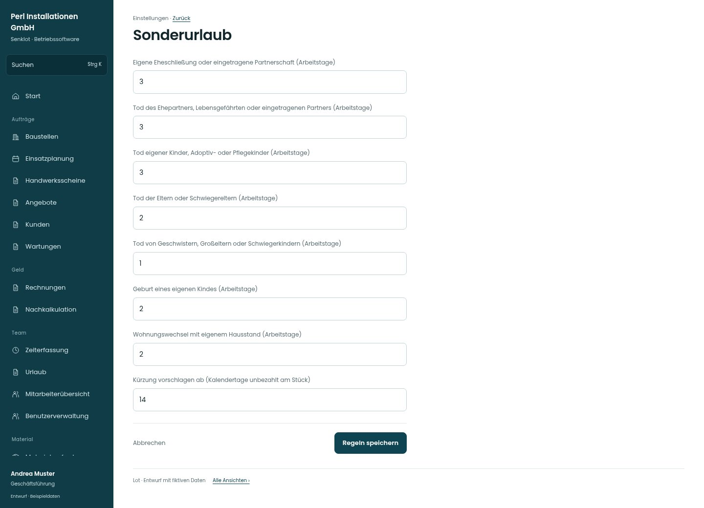

# Sonderurlaub

[Zur Übersicht](../README.md) · [Bereich: Einstellungen](../bereiche/einstellungen.md)

**Einstellungen · Geschäftsführung · /settings/personal · Sonderurlaub**

Gestaltungsentwurf mit fiktiven Beispieldaten. Aktionen und Datenänderungen sind lokal simuliert, ohne Backend.

[Desktop](../bilder/147-personal-sonder-desktop.jpg) · [Tablet](../bilder/147-personal-sonder-tablet.jpg) · [Mobil](../bilder/147-personal-sonder-mobil.jpg)

## Aufbau

Die vollständige Anlassliste bleibt sichtbar und lesbar; lange Bezeichnungen umbrechen statt die Anspruchsfälle zu streichen.

## Vorhandene Funktionen für die spätere Umsetzung erhalten

- Vollständige vorhandene Anlassliste
- Gesetzliche/vertragliche Freigrenzen nicht neu definieren
- Grund für Tage darüber

## Felder im Beispiel

- Eigene Eheschließung oder eingetragene Partnerschaft (Arbeitstage)
- Tod des Ehepartners, Lebensgefährten oder eingetragenen Partners (Arbeitstage)
- Tod eigener Kinder, Adoptiv- oder Pflegekinder (Arbeitstage)
- Tod der Eltern oder Schwiegereltern (Arbeitstage)
- Tod von Geschwistern, Großeltern oder Schwiegerkindern (Arbeitstage)
- Geburt eines eigenen Kindes (Arbeitstage)
- Wohnungswechsel mit eigenem Hausstand (Arbeitstage)
- Kürzung vorschlagen ab (Kalendertage unbezahlt am Stück)

## Aktionen

- Regeln speichern

## Quellen

Quellstand: `3e49090`.
- [src/features/settings/SonderurlaubKarte.tsx](https://github.com/juliandeutsch22/Prototype-App-Installateure/blob/3e49090d4054ebbd3ecbce6ab583bb944c2c0770/src/features/settings/SonderurlaubKarte.tsx)

Die Screens zeigen die vorgesehenen Bedienwege. Reale Speicherung, vollständige Rollenprüfung, Berechnungen, Exporte, Benachrichtigungen und Integrationen müssen bei einer Umsetzung gegen die App geprüft werden.
