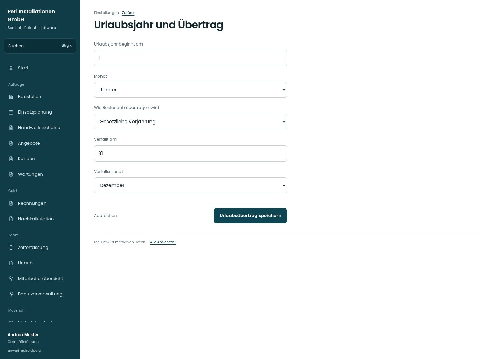

# Urlaubsjahr und Übertrag

[Zur Übersicht](../README.md) · [Bereich: Einstellungen](../bereiche/einstellungen.md)

**Einstellungen · Geschäftsführung · /settings/personal · Urlaub**

Gestaltungsentwurf mit fiktiven Beispieldaten. Aktionen und Datenänderungen sind lokal simuliert, ohne Backend.

[Desktop](../bilder/143-personal-urlaub-desktop.jpg) · [Tablet](../bilder/143-personal-urlaub-tablet.jpg) · [Mobil](../bilder/143-personal-urlaub-mobil.jpg)

## Aufbau

Verfallsdatum nur beim passenden Übertragsmodell zeigen; Urlaubsjahr und Kalenderjahr bleiben fachlich getrennt.

## Vorhandene Funktionen für die spätere Umsetzung erhalten

- Jahresübergreifende Anträge
- Urlaubsjahr vs Kalenderjahr
- Kein stiller Bestandsumbau
- Verfallstag nur bei gewähltem Stichtagsmodell sichtbar; rechtlicher Hinweis bleibt in der Hilfe

## Felder im Beispiel

- Urlaubsjahr beginnt am
- Monat
- Wie Resturlaub übertragen wird
- Verfällt am
- Verfallsmonat

## Aktionen

- Urlaubsübertrag speichern

## Quellen

Quellstand: `3e49090`.
- [src/features/settings/SettingsView.tsx](https://github.com/juliandeutsch22/Prototype-App-Installateure/blob/3e49090d4054ebbd3ecbce6ab583bb944c2c0770/src/features/settings/SettingsView.tsx)

Die Screens zeigen die vorgesehenen Bedienwege. Reale Speicherung, vollständige Rollenprüfung, Berechnungen, Exporte, Benachrichtigungen und Integrationen müssen bei einer Umsetzung gegen die App geprüft werden.
