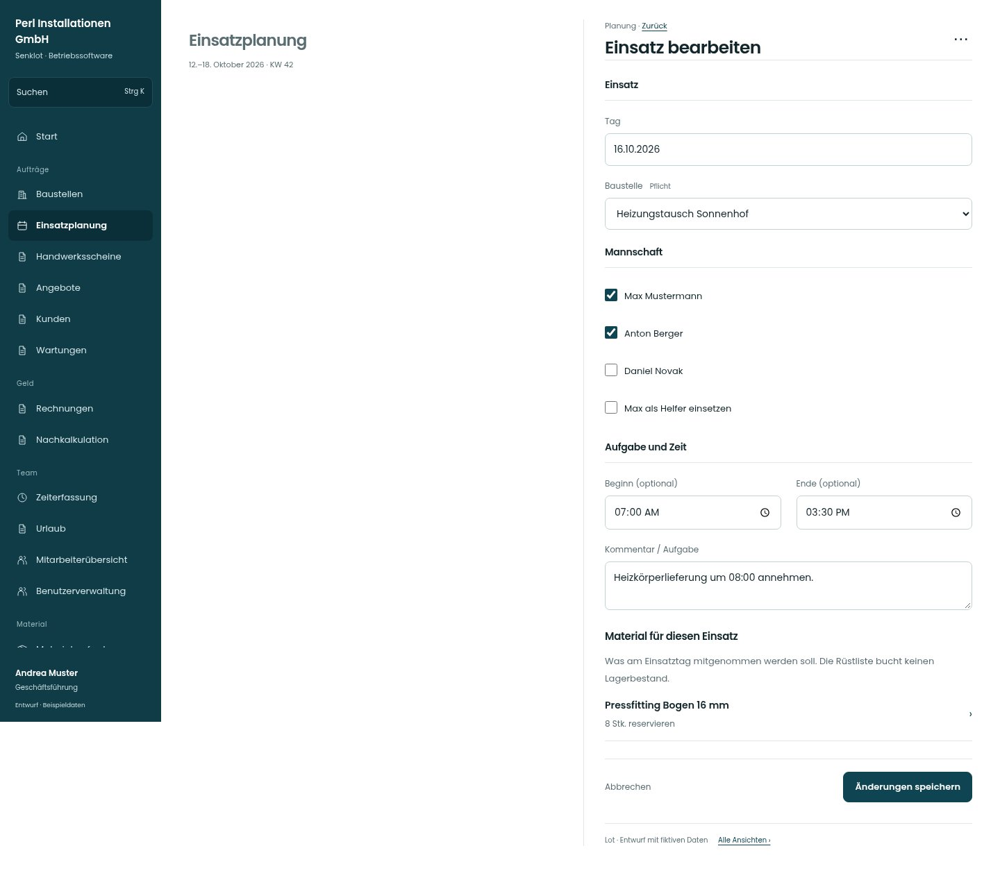

# Einsatz bearbeiten

[Zur Übersicht](../README.md) · [Bereich: Planung](../bereiche/planung.md)

**Planung · Geschäftsführung · /assignments · Einsatzfenster**

Gestaltungsentwurf mit fiktiven Beispieldaten. Aktionen und Datenänderungen sind lokal simuliert, ohne Backend.

[Desktop](../bilder/257-planung-einsatz-bearbeiten-desktop.jpg) · [Tablet](../bilder/257-planung-einsatz-bearbeiten-tablet.jpg) · [Mobil](../bilder/257-planung-einsatz-bearbeiten-mobil.jpg)

## Aufbau

Mannschaft als Mehrfachauswahl, Helferzuordnung und Rüstliste gemeinsam bearbeiten; vorhandene Einteilung vor dem Speichern übernehmen.

## Vorhandene Funktionen für die spätere Umsetzung erhalten

- Doppelbelegung
- Lehrlinge korrekt einstufen
- Gespeicherte Einteilung bleibt bei Fehler sichtbar

## Felder im Beispiel

- Tag
- Baustelle (Pflichtfeld)
- Max Mustermann
- Anton Berger
- Daniel Novak
- Max als Helfer einsetzen
- Beginn (optional)
- Ende (optional)
- Kommentar / Aufgabe

## Aktionen

- Änderungen speichern
- Material planen
- Einsatz löschen

## Quellen

Quellstand: `3e49090`.
- [src/features/assignments/EinsatzFenster.tsx](https://github.com/juliandeutsch22/Prototype-App-Installateure/blob/3e49090d4054ebbd3ecbce6ab583bb944c2c0770/src/features/assignments/EinsatzFenster.tsx)
- [src/features/assignments/EinsatzFormular.tsx](https://github.com/juliandeutsch22/Prototype-App-Installateure/blob/3e49090d4054ebbd3ecbce6ab583bb944c2c0770/src/features/assignments/EinsatzFormular.tsx)

Die Screens zeigen die vorgesehenen Bedienwege. Reale Speicherung, vollständige Rollenprüfung, Berechnungen, Exporte, Benachrichtigungen und Integrationen müssen bei einer Umsetzung gegen die App geprüft werden.
