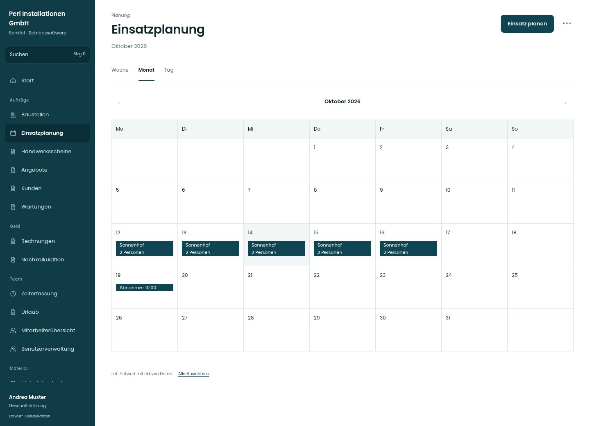

# Einsatzplanung

[Zur Übersicht](../README.md) · [Bereich: Planung](../bereiche/planung.md)

**Planung · Geschäftsführung · /assignments/woche?ansicht=monat**

Gestaltungsentwurf mit fiktiven Beispieldaten. Aktionen und Datenänderungen sind lokal simuliert, ohne Backend.

[Desktop](../bilder/041-planung-monat-desktop.jpg) · [Tablet](../bilder/041-planung-monat-tablet.jpg) · [Mobil](../bilder/041-planung-monat-mobil.jpg)

## Aufbau

Der Monat orientiert über den Zeitraum und führt in die betreffende Woche; Planungseinstiege bleiben an Personen, Baustellen und zulässige Tage gebunden.

## Vorhandene Funktionen für die spätere Umsetzung erhalten

- Personen-/Baustellenansicht
- Tag/Woche/Monat
- Abwesenheiten und Verfügbarkeit
- Einteilung bearbeiten/löschen
- Materialbedarf
- Kalender-Abo

## Register und Filter

- Woche → [planung-woche](planung-woche.md)
- Monat → [planung-monat](planung-monat.md)
- Tag → [planung-tag](planung-tag.md)

## Aktionen

- Einsatz planen
- Kalender abonnieren

## Quellen

Quellstand: `3e49090`.
- [src/features/assignments/WochenplanView.tsx](https://github.com/juliandeutsch22/Prototype-App-Installateure/blob/3e49090d4054ebbd3ecbce6ab583bb944c2c0770/src/features/assignments/WochenplanView.tsx)
- [src/features/assignments/MonatsAnsicht.tsx](https://github.com/juliandeutsch22/Prototype-App-Installateure/blob/3e49090d4054ebbd3ecbce6ab583bb944c2c0770/src/features/assignments/MonatsAnsicht.tsx)
- [src/features/assignments/AssignmentsView.tsx](https://github.com/juliandeutsch22/Prototype-App-Installateure/blob/3e49090d4054ebbd3ecbce6ab583bb944c2c0770/src/features/assignments/AssignmentsView.tsx)

Die Screens zeigen die vorgesehenen Bedienwege. Reale Speicherung, vollständige Rollenprüfung, Berechnungen, Exporte, Benachrichtigungen und Integrationen müssen bei einer Umsetzung gegen die App geprüft werden.
