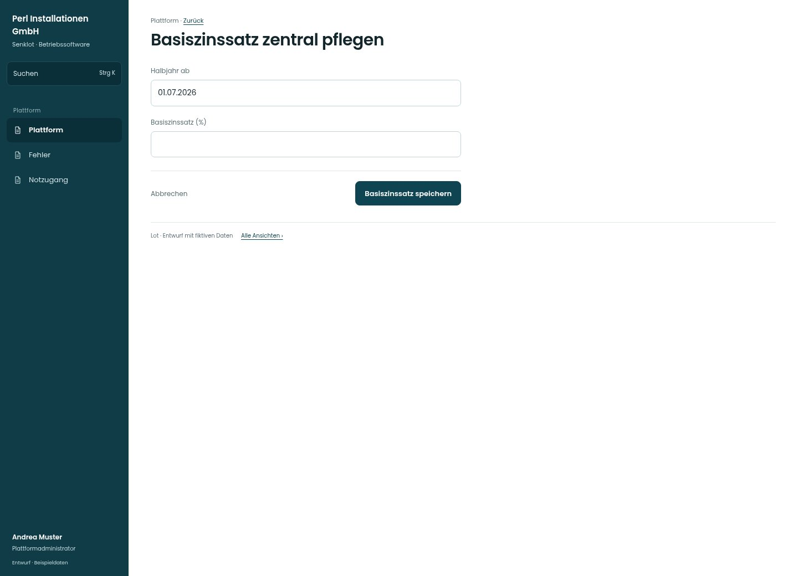

# Basiszinssatz zentral pflegen

[Zur Übersicht](../README.md) · [Bereich: Plattform](../bereiche/plattform.md)

**Plattform · Plattformadministrator · /plattform · Basiszinssatz**

Gestaltungsentwurf mit fiktiven Beispieldaten. Aktionen und Datenänderungen sind lokal simuliert, ohne Backend.

[Desktop](../bilder/162-plattform-basiszins-desktop.jpg) · [Tablet](../bilder/162-plattform-basiszins-tablet.jpg) · [Mobil](../bilder/162-plattform-basiszins-mobil.jpg)

## Aufbau

Gültigkeitsbeginn und dokumentierter Satz genügen; keine erfundene aktuelle Zahl oder neue Zinsregel ergänzen.

## Vorhandene Funktionen für die spätere Umsetzung erhalten

- Keine erfundene aktuelle Rate
- Gültigkeitszeitpunkt und Verlauf
- Änderung wirkt nach bestehender Regel

## Felder im Beispiel

- Halbjahr ab
- Basiszinssatz (%)

## Aktionen

- Basiszinssatz speichern

## Quellen

Quellstand: `3e49090`.
- [src/features/plattform/BasiszinsZentral.tsx](https://github.com/juliandeutsch22/Prototype-App-Installateure/blob/3e49090d4054ebbd3ecbce6ab583bb944c2c0770/src/features/plattform/BasiszinsZentral.tsx)

Die Screens zeigen die vorgesehenen Bedienwege. Reale Speicherung, vollständige Rollenprüfung, Berechnungen, Exporte, Benachrichtigungen und Integrationen müssen bei einer Umsetzung gegen die App geprüft werden.
