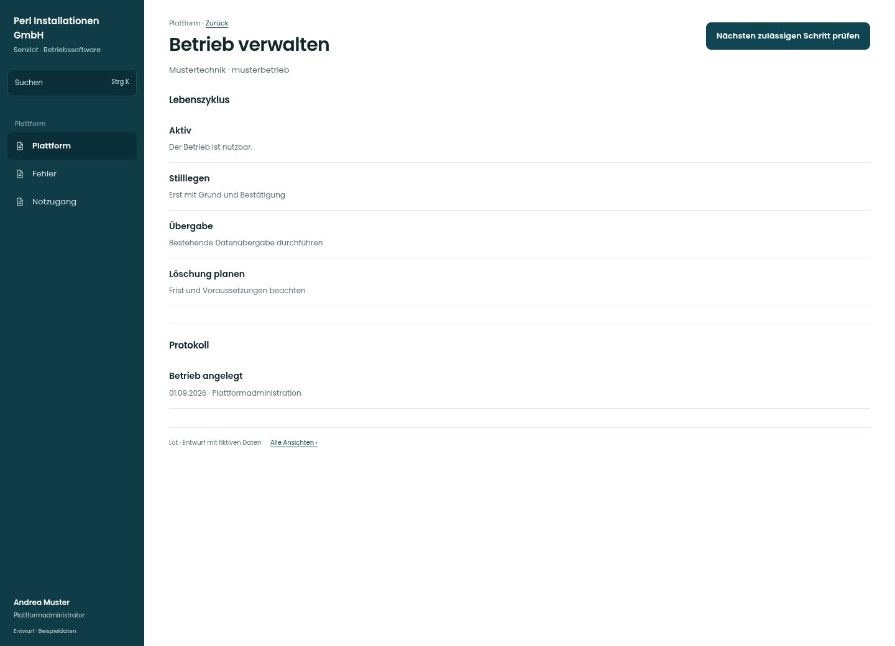

# Betrieb verwalten

[Zur Übersicht](../README.md) · [Bereich: Plattform](../bereiche/plattform.md)

**Plattform · Plattformadministrator · /plattform · Betriebsfenster**

Gestaltungsentwurf mit fiktiven Beispieldaten. Aktionen und Datenänderungen sind lokal simuliert, ohne Backend.

[Desktop](../bilder/156-plattform-betrieb-desktop.jpg) · [Tablet](../bilder/156-plattform-betrieb-tablet.jpg) · [Mobil](../bilder/156-plattform-betrieb-mobil.jpg)

## Aufbau

Lebenszyklus, Grund und Protokoll sind der Arbeitskontext; keinen neuen pauschalen Löschknopf anbieten.

## Vorhandene Funktionen für die spätere Umsetzung erhalten

- Stilllegen→Übergabe→Löschfrist→Löschen
- Testbetrieb-Ausnahme nur wie Bestand
- Kennungsbestätigung
- Kein neuer pauschaler Löschknopf

## Felder im Beispiel

- Grund (steht im Protokoll) (Pflichtfeld)
- Frist (Tage)
- Zur Löschbestätigung die Kennung eintippen

## Aktionen

- Nächsten zulässigen Schritt prüfen

## Quellen

Quellstand: `3e49090`.
- [src/features/plattform/BetriebVerwalten.tsx](https://github.com/juliandeutsch22/Prototype-App-Installateure/blob/3e49090d4054ebbd3ecbce6ab583bb944c2c0770/src/features/plattform/BetriebVerwalten.tsx)
- [src/features/plattform/PlattformView.tsx](https://github.com/juliandeutsch22/Prototype-App-Installateure/blob/3e49090d4054ebbd3ecbce6ab583bb944c2c0770/src/features/plattform/PlattformView.tsx)

Die Screens zeigen die vorgesehenen Bedienwege. Reale Speicherung, vollständige Rollenprüfung, Berechnungen, Exporte, Benachrichtigungen und Integrationen müssen bei einer Umsetzung gegen die App geprüft werden.
