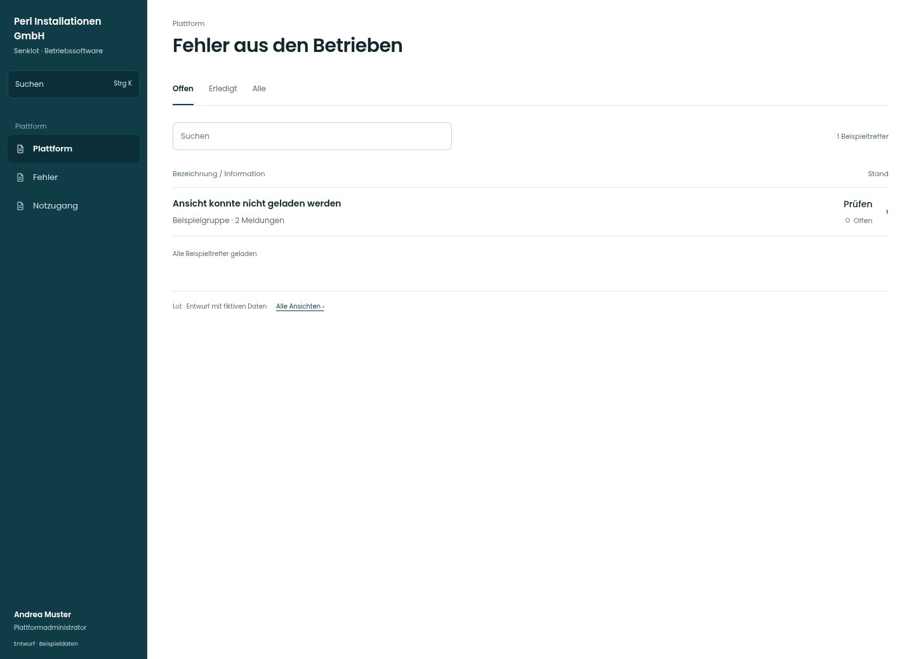

# Fehler aus den Betrieben

[Zur Übersicht](../README.md) · [Bereich: Plattform](../bereiche/plattform.md)

**Plattform · Plattformadministrator · /plattform · Fehler**

Gestaltungsentwurf mit fiktiven Beispieldaten. Aktionen und Datenänderungen sind lokal simuliert, ohne Backend.

[Desktop](../bilder/157-plattform-fehler-desktop.jpg) · [Tablet](../bilder/157-plattform-fehler-tablet.jpg) · [Mobil](../bilder/157-plattform-fehler-mobil.jpg)

## Aufbau

Gruppierte Fehler und Vorkommen in sachlichen Zeilen; keine echten personenbezogenen Fehlermeldungen in der Vorschau.

## Vorhandene Funktionen für die spätere Umsetzung erhalten

- Gruppierte Meldungen
- Rohdetails nur berechtigter Support
- Keine echten Fehlermeldungen/Personendaten im Entwurf

## Register und Filter

- Offen
- Erledigt
- Alle

## Quellen

Quellstand: `3e49090`.
- [src/features/plattform/FehlerListe.tsx](https://github.com/juliandeutsch22/Prototype-App-Installateure/blob/3e49090d4054ebbd3ecbce6ab583bb944c2c0770/src/features/plattform/FehlerListe.tsx)

Die Screens zeigen die vorgesehenen Bedienwege. Reale Speicherung, vollständige Rollenprüfung, Berechnungen, Exporte, Benachrichtigungen und Integrationen müssen bei einer Umsetzung gegen die App geprüft werden.
