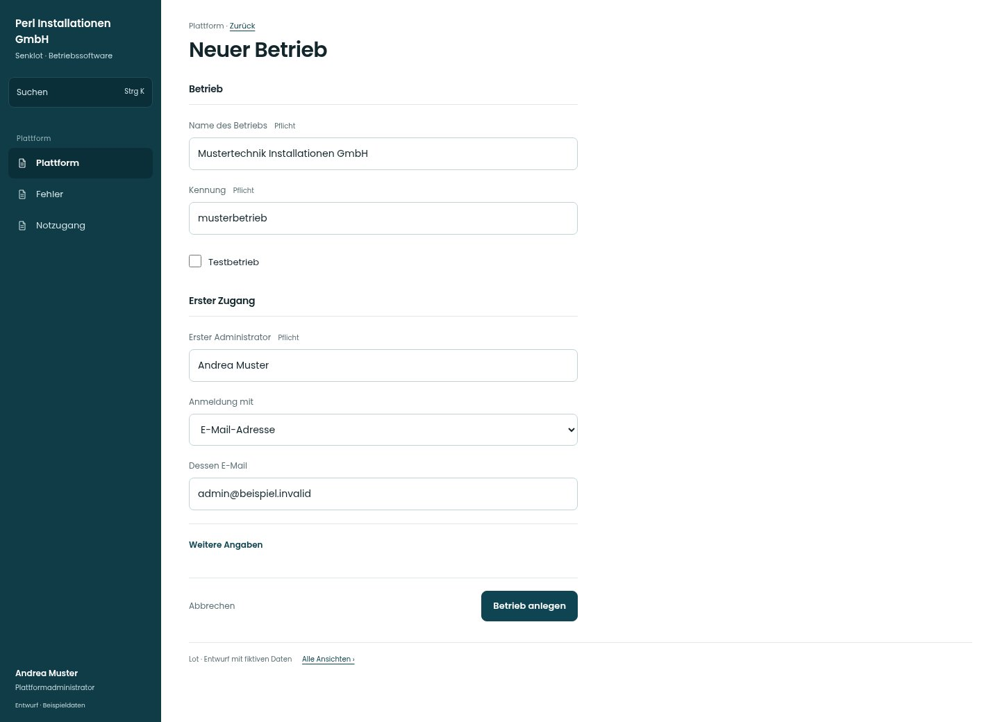

# Neuer Betrieb

[Zur Übersicht](../README.md) · [Bereich: Plattform](../bereiche/plattform.md)

**Plattform · Plattformadministrator · /plattform · Betrieb anlegen**

Gestaltungsentwurf mit fiktiven Beispieldaten. Aktionen und Datenänderungen sind lokal simuliert, ohne Backend.

[Desktop](../bilder/155-plattform-neu-desktop.jpg) · [Tablet](../bilder/155-plattform-neu-tablet.jpg) · [Mobil](../bilder/155-plattform-neu-mobil.jpg)

## Aufbau

Betriebskennung und ersten Zugang getrennt gliedern; einmalige Übergabe und Testbetriebsstatus bleiben explizit.

## Vorhandene Funktionen für die spätere Umsetzung erhalten

- Einmalige Übergabe Link/Startpasswort
- Betriebskennung eindeutig
- Keine wiederverwendbaren Geheimnisse im Mockup

## Felder im Beispiel

- Name des Betriebs (Pflichtfeld)
- Kennung (Pflichtfeld)
- Erster Administrator (Pflichtfeld)
- Anmeldung mit
- Dessen E-Mail
- Benutzername
- Testbetrieb

## Aktionen

- Betrieb anlegen

## Quellen

Quellstand: `3e49090`.
- [src/features/plattform/PlattformView.tsx](https://github.com/juliandeutsch22/Prototype-App-Installateure/blob/3e49090d4054ebbd3ecbce6ab583bb944c2c0770/src/features/plattform/PlattformView.tsx)

Die Screens zeigen die vorgesehenen Bedienwege. Reale Speicherung, vollständige Rollenprüfung, Berechnungen, Exporte, Benachrichtigungen und Integrationen müssen bei einer Umsetzung gegen die App geprüft werden.
