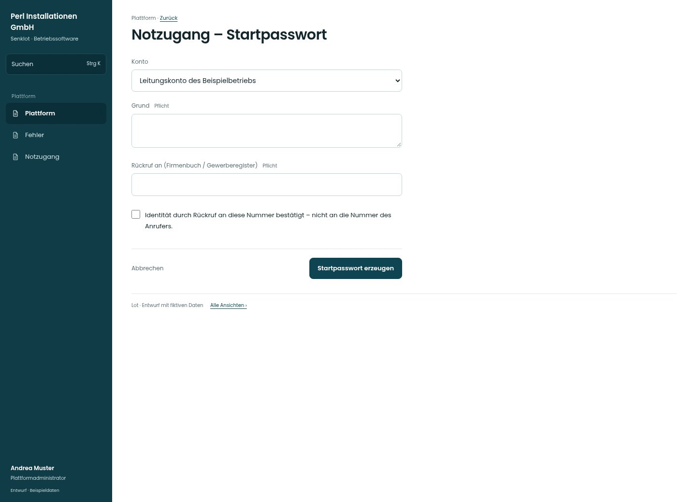

# Notzugang – Startpasswort

[Zur Übersicht](../README.md) · [Bereich: Plattform](../bereiche/plattform.md)

**Plattform · Plattformadministrator · /plattform · Notzugang**

Gestaltungsentwurf mit fiktiven Beispieldaten. Aktionen und Datenänderungen sind lokal simuliert, ohne Backend.

[Desktop](../bilder/160-plattform-notpasswort-desktop.jpg) · [Tablet](../bilder/160-plattform-notpasswort-tablet.jpg) · [Mobil](../bilder/160-plattform-notpasswort-mobil.jpg)

## Aufbau

Kontowahl und bestätigte Identität vor Reset; keine Abkürzung um den aktiven Notzugang.

## Vorhandene Funktionen für die spätere Umsetzung erhalten

- Aktiver Notzugang nötig
- Identitätsprüfung bleibt ausdrücklich
- Kein echtes Kennwort/Code in der Vorschau

## Felder im Beispiel

- Konto
- Grund (Pflichtfeld)
- Rückruf an (Firmenbuch / Gewerberegister) (Pflichtfeld)
- Identität durch Rückruf an diese Nummer bestätigt – nicht an die Nummer des Anrufers.

## Aktionen

- Startpasswort erzeugen

## Quellen

Quellstand: `3e49090`.
- [src/features/plattform/NotzugangPasswort.tsx](https://github.com/juliandeutsch22/Prototype-App-Installateure/blob/3e49090d4054ebbd3ecbce6ab583bb944c2c0770/src/features/plattform/NotzugangPasswort.tsx)

Die Screens zeigen die vorgesehenen Bedienwege. Reale Speicherung, vollständige Rollenprüfung, Berechnungen, Exporte, Benachrichtigungen und Integrationen müssen bei einer Umsetzung gegen die App geprüft werden.
