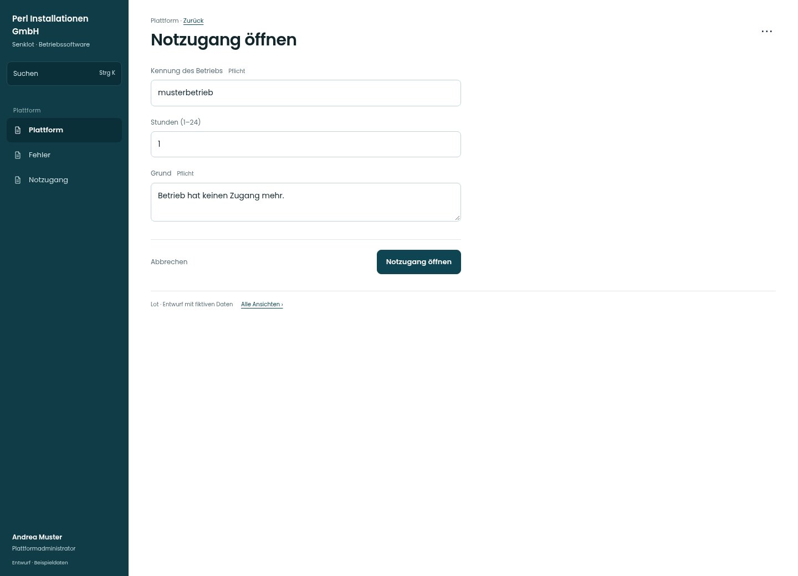

# Notzugang öffnen

[Zur Übersicht](../README.md) · [Bereich: Plattform](../bereiche/plattform.md)

**Plattform · Plattformadministrator · /plattform · Notzugang**

Gestaltungsentwurf mit fiktiven Beispieldaten. Aktionen und Datenänderungen sind lokal simuliert, ohne Backend.

[Desktop](../bilder/159-plattform-notzugang-desktop.jpg) · [Tablet](../bilder/159-plattform-notzugang-tablet.jpg) · [Mobil](../bilder/159-plattform-notzugang-mobil.jpg)

## Aufbau

Kennung, Dauer und Grund bilden einen geschützten Vorgang; Notpasswort und Faktorreset bleiben eigenständige Wege.

## Vorhandene Funktionen für die spätere Umsetzung erhalten

- Befristung und Protokoll
- Keine automatische Einsicht nur durch Kenntnis der Kennung
- Kontrollierte Notfallrechte

## Felder im Beispiel

- Kennung des Betriebs (Pflichtfeld)
- Stunden (1–24)
- Grund (Pflichtfeld)

## Aktionen

- Notzugang öffnen
- Startpasswort zurücksetzen
- Zweiten Faktor zurücksetzen

## Quellen

Quellstand: `3e49090`.
- [src/features/plattform/PlattformView.tsx](https://github.com/juliandeutsch22/Prototype-App-Installateure/blob/3e49090d4054ebbd3ecbce6ab583bb944c2c0770/src/features/plattform/PlattformView.tsx)

Die Screens zeigen die vorgesehenen Bedienwege. Reale Speicherung, vollständige Rollenprüfung, Berechnungen, Exporte, Benachrichtigungen und Integrationen müssen bei einer Umsetzung gegen die App geprüft werden.
