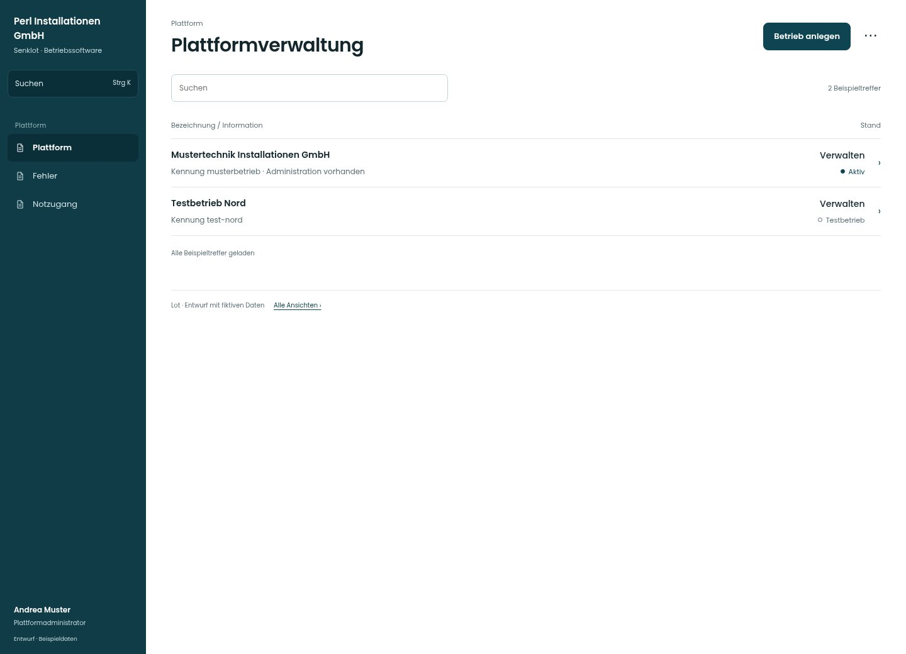

# Plattformverwaltung

[Zur Übersicht](../README.md) · [Bereich: Plattform](../bereiche/plattform.md)

**Plattform · Plattformadministrator · /plattform**

Gestaltungsentwurf mit fiktiven Beispieldaten. Aktionen und Datenänderungen sind lokal simuliert, ohne Backend.

[Desktop](../bilder/154-plattform-desktop.jpg) · [Tablet](../bilder/154-plattform-tablet.jpg) · [Mobil](../bilder/154-plattform-mobil.jpg)

## Aufbau

Betriebe nach Status auflisten; Plattformrolle erhält durch die Oberfläche keinen beiläufigen Zugriff auf Betriebsdaten.

## Vorhandene Funktionen für die spätere Umsetzung erhalten

- Plattformkonto hat keinen Betriebszugriff
- Einblick nur mit Freigabe/Notzugang
- Gelöschte separat
- Eigene MFA/Passwort erreichbar

## Aktionen

- Betrieb anlegen
- Fehler aus Betrieben
- Notzugang
- Basiszinssatz

## Quellen

Quellstand: `3e49090`.
- [src/features/plattform/PlattformView.tsx](https://github.com/juliandeutsch22/Prototype-App-Installateure/blob/3e49090d4054ebbd3ecbce6ab583bb944c2c0770/src/features/plattform/PlattformView.tsx)

Die Screens zeigen die vorgesehenen Bedienwege. Reale Speicherung, vollständige Rollenprüfung, Berechnungen, Exporte, Benachrichtigungen und Integrationen müssen bei einer Umsetzung gegen die App geprüft werden.
