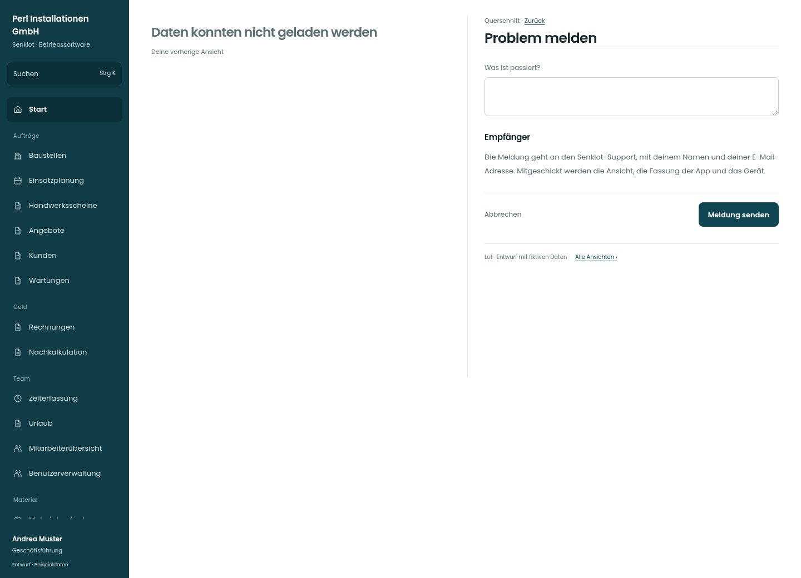

# Problem melden

[Zur Übersicht](../README.md) · [Bereich: Querschnitt](../bereiche/querschnitt.md)

**Querschnitt · Geschäftsführung · Fehlerzustand · Problem melden**

Gestaltungsentwurf mit fiktiven Beispieldaten. Aktionen und Datenänderungen sind lokal simuliert, ohne Backend.

[Desktop](../bilder/200-problem-melden-desktop.jpg) · [Tablet](../bilder/200-problem-melden-tablet.jpg) · [Mobil](../bilder/200-problem-melden-mobil.jpg)

## Aufbau

Ein Beschreibungsfeld mit transparentem Empfänger genügt; technische Details nicht als zusätzliche Pflichtangaben verlangen.

## Vorhandene Funktionen für die spätere Umsetzung erhalten

- Keine unnötigen neuen Pflichtdaten
- Bestehender Supportweg
- Fehlerdetail und Nutzereingabe getrennt

## Felder im Beispiel

- Was ist passiert?

## Aktionen

- Meldung senden

## Quellen

Quellstand: `3e49090`.
- [src/components/ProblemMelden.tsx](https://github.com/juliandeutsch22/Prototype-App-Installateure/blob/3e49090d4054ebbd3ecbce6ab583bb944c2c0770/src/components/ProblemMelden.tsx)

Die Screens zeigen die vorgesehenen Bedienwege. Reale Speicherung, vollständige Rollenprüfung, Berechnungen, Exporte, Benachrichtigungen und Integrationen müssen bei einer Umsetzung gegen die App geprüft werden.
