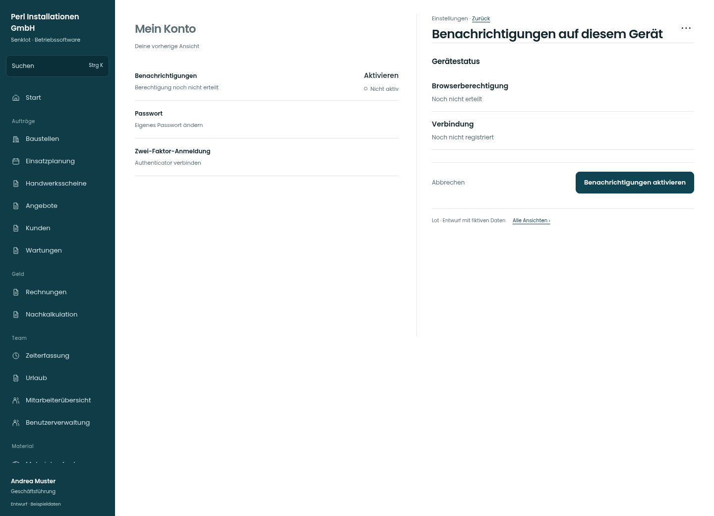

# Benachrichtigungen auf diesem Gerät

[Zur Übersicht](../README.md) · [Bereich: Einstellungen](../bereiche/einstellungen.md)

**Einstellungen · Geschäftsführung · /settings/meldungen · Gerät**

Gestaltungsentwurf mit fiktiven Beispieldaten. Aktionen und Datenänderungen sind lokal simuliert, ohne Backend.

[Desktop](../bilder/136-push-einrichten-desktop.jpg) · [Tablet](../bilder/136-push-einrichten-tablet.jpg) · [Mobil](../bilder/136-push-einrichten-mobil.jpg)

## Aufbau

Zustand dieses Geräts und konkrete Aktivierung trennen; keine bereits erteilte Browserberechtigung behaupten.

## Vorhandene Funktionen für die spätere Umsetzung erhalten

- Nicht unterstützt/abgelehnt/unbekannt unterscheiden
- iOS Installation berücksichtigen
- Erfolg erst nach echtem Test

## Aktionen

- Benachrichtigungen aktivieren
- Testmeldung senden

## Quellen

Quellstand: `3e49090`.
- [src/features/settings/PushStatus.tsx](https://github.com/juliandeutsch22/Prototype-App-Installateure/blob/3e49090d4054ebbd3ecbce6ab583bb944c2c0770/src/features/settings/PushStatus.tsx)
- [src/features/settings/NotificationSettings.tsx](https://github.com/juliandeutsch22/Prototype-App-Installateure/blob/3e49090d4054ebbd3ecbce6ab583bb944c2c0770/src/features/settings/NotificationSettings.tsx)

Die Screens zeigen die vorgesehenen Bedienwege. Reale Speicherung, vollständige Rollenprüfung, Berechnungen, Exporte, Benachrichtigungen und Integrationen müssen bei einer Umsetzung gegen die App geprüft werden.
